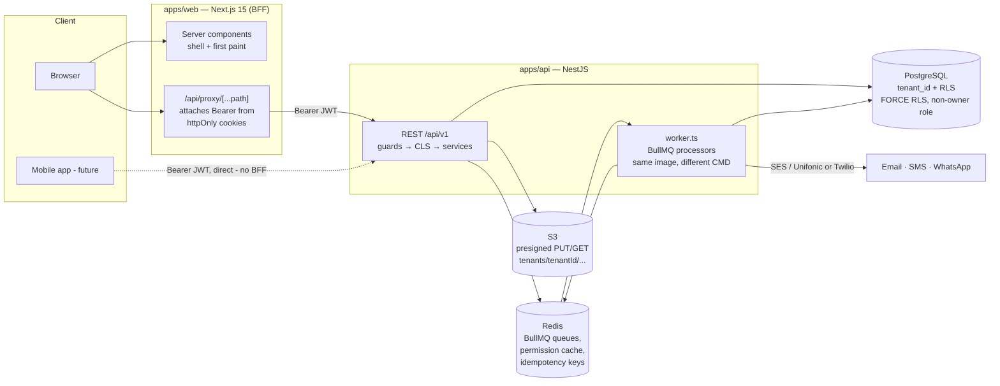

# Keystone HR — System Architecture

> One-line summary: Multi-tenant salon-management SaaS for Oman/GCC — Next.js 15 web app (BFF) + NestJS API + PostgreSQL with row-level security, run as a Turborepo monorepo on AWS.

`status:` **Foundation scaffold BUILT** (monorepo, `packages/shared`, auth, tenancy/RLS, RBAC guards, branches module, web shell). Everything else (customers, catalog, appointments, POS, inventory, loyalty, finance, dashboard, notifications, exports, mobile) is **PLANNED**. Per-area status markers appear in each linked doc.

This is the master document. Read it first; drill into the linked docs for depth.

| Doc | Covers |
| --- | --- |
| [DATA-MODEL.md](./DATA-MODEL.md) | All ~40 tables, ER diagram, column conventions (UUIDv7, baisa money, soft delete) |
| [MULTI-TENANCY.md](./MULTI-TENANCY.md) | RLS deep dive: `set_config` pattern, pooling trap, non-owner role, CI assertions |
| [RBAC.md](./RBAC.md) | Permission catalog, roles, guard chain, branch scoping |
| [API-CONVENTIONS.md](./API-CONVENTIONS.md) | REST/versioning, pagination, zod validation, errors, idempotency, exports, OpenAPI |
| [FRONTEND.md](./FRONTEND.md) | App Router structure, i18n/RTL rules, BFF auth, data fetching, forms, money/date display |

---

## 1. Product context

Keystone HR is a **multi-tenant SaaS for salon/barbershop chains**, initially targeting **Oman and the wider GCC**:

- **Tenants** are salon businesses; each tenant operates one or more **branches** (corporate-owned or franchise). All data is partitioned by `tenant_id` and protected by Postgres row-level security.
- **Bilingual English + Arabic**, with **full RTL** support in the web UI. Arabic is not an afterthought: RTL correctness is enforced by lint from the first component (see [FRONTEND.md](./FRONTEND.md#rtl-rules)).
- **Currency: OMR with 3 decimal places.** All money is stored as **BIGINT baisa** (1 OMR = 1000 baisa) and only formatted at the display edge. VAT (5% in Oman) is computed in baisa. See [DATA-MODEL.md](./DATA-MODEL.md#conventions).
- Domain scope: branches, customers, service catalog, appointments, POS checkout, inventory & procurement, loyalty, staff & commissions, a simple finance ledger, dashboards/KPIs, notifications (SMS/WhatsApp/email), exports.
- Team size: 2–4 developers. Architecture choices deliberately favor a **modular monolith** with boring, well-understood tools over distributed complexity.

### Build phasing (MVP order)

1. **Foundations** — monorepo, CI, RLS + CLS + auth + RBAC, web shell with i18n/RTL. *De-risk RLS first.* ← **this is what exists today**
2. Catalog + Customers
3. Appointments (status machine, availability, booking wizard)
4. POS (the checkout transaction — heart of the product)
5. Loyalty
6. Dashboard + exports + notifications
7. Inventory screens, settings, staff config

**Deferred past MVP:** full finance (AR/AP aging, reconciliation, formal P&L), the procurement chain (PR/PO/GRN — MVP uses manual stock adjustments), transfer approvals, custom role-builder UI, WhatsApp channel, promotions beyond percent/fixed codes, EKS, mobile `api-client`. (Payroll runs/payslips shipped as v1 — see `docs/MODULES/payroll.md`.)

---

## 2. Locked tech decisions

These decisions are **fixed**. Do not re-litigate them in future sessions; extend within them.

| Decision | Choice | Rationale |
| --- | --- | --- |
| Web framework | **Next.js 15 (App Router)** | Server components for shell/first paint; route handlers give us a BFF so the browser never holds tokens in JS; first-class i18n routing via `[locale]` segment. |
| API framework | **NestJS** | Module system maps 1:1 to business domains; DI + guards/interceptors give clean seams for auth, RBAC, audit, CLS; mature ecosystem (nestjs-zod, nestjs-cls, @nestjs/swagger, @nestjs/event-emitter). |
| ORM | **Prisma** | Type-safe client shared with the schema; client extensions let us inject tenant context on *every* query (see [MULTI-TENANCY.md](./MULTI-TENANCY.md)); `migrate dev --create-only` lets us hand-write RLS SQL into migrations. |
| Database | **PostgreSQL + `tenant_id` + Row-Level Security** | Single database, shared schema — cheapest to operate at 2–4 devs. RLS is defense-in-depth beneath app-layer filtering; a missed `where tenantId` becomes a zero-rows bug, not a data leak. |
| Auth | **Self-managed JWT** (argon2id password hashing, refresh tokens in DB) | No per-MAU vendor cost; tokens carry `tenantId`/`roleId`/`branchIds` claims that drive tenancy + RBAC; refresh tokens are hashed rows we can revoke per device. |
| Monorepo | **Turborepo + pnpm** | One repo for web + api + shared zod schemas = one source of truth for every DTO; remote-cacheable pipelines; pnpm workspaces keep installs fast and strict. |
| Jobs | **BullMQ 5 + Redis** | Redis is already required (permission cache, idempotency keys); BullMQ gives retries/repeatables for notifications, exports, loyalty expiry without a broker. Explicitly **no outbox, no message broker** in v1. |
| Runtime infra | **AWS ECS Fargate now → EKS later** | Fargate is the lowest-ops container platform for a small team; the app is a stateless 12-factor container (api, worker, web) so the EKS move later is a re-platform, not a rewrite. |
| Files | **S3 presigned PUT/GET** | API validates then presigns; bytes never proxy through the app. Keys namespaced `tenants/{tenantId}/...`. |
| Language/runtime | Node 22 LTS, TypeScript 5.5+, pnpm 9, Turborepo 2 | Current LTS baseline for the whole repo. |

---

## 3. System overview



Key properties:

- The **browser talks only to the Next.js origin**. Tokens live in httpOnly cookies; the proxy route handler swaps cookie → `Authorization: Bearer` on the way to the API. The future **mobile app skips the BFF** and calls the API directly with a Bearer token. Details in [FRONTEND.md](./FRONTEND.md#bff-auth).
- **API and worker are the same Docker image** with a different CMD (`main.ts` vs `worker.ts`). Queues: `notifications`, `exports`, `scheduled`. Repeatable jobs: loyalty-point expiry (daily 03:00 Asia/Muscat), appointment reminders (hourly scan), low-stock digest, refresh-token pruning.
- **Migrations run as a one-off ECS task before deploy**, connecting as the owner role `hayryou_migrator`. The app connects as non-owner `hayryou_app` so RLS actually applies ([MULTI-TENANCY.md](./MULTI-TENANCY.md#non-owner-role)).
- Observability: nestjs-pino JSON logs carrying `tenantId`/`requestId` from CLS; Sentry in both apps; `/healthz` + `/ready` endpoints.

---

## 4. Monorepo layout

```
hayryou/
├── apps/
│   ├── web/                  # Next.js 15 App Router (BFF + UI)        [BUILT: shell]
│   │   └── app/[locale]/     #   (auth)/ and (dashboard)/ route groups
│   └── api/                  # NestJS REST API + BullMQ worker          [BUILT: core]
│       └── src/modules/      #   auth, tenants, users, branches,
│                             #   staff, payroll, attendance, leave [BUILT]
│                             #   customers, services, appointments, pos,
│                             #   inventory, procurement, loyalty,
│                             #   finance, commissions, dashboard,
│                             #   notifications, settings, audit, exports [PLANNED]
├── packages/
│   ├── shared/               # zod schemas + inferred types + enums +   [BUILT]
│   │   │                     # permissions catalog + money helpers.
│   │   │                     # ZERO runtime deps beyond zod.
│   │   └── src/permissions.ts  # THE source of truth for permission keys
│   ├── config/               # eslint / tsconfig / prettier presets     [BUILT]
│   └── api-client/           # generated OpenAPI client for mobile      [PLANNED]
├── infra/                    # Terraform (ECS Fargate, RDS, Redis, S3)
├── docs/                     # you are here
└── .github/workflows/        # CI: lint, typecheck, test, RLS assertions
```

**The shared-DTO flow** is the backbone of the monorepo: every request/response shape is a zod schema in `packages/shared`. NestJS validates it via **nestjs-zod** (`createZodDto` + a global `ZodValidationPipe`); Next.js consumes the *same* schema through react-hook-form zod resolvers. One schema, both sides — drift is impossible. Code examples in [API-CONVENTIONS.md](./API-CONVENTIONS.md#validation) and [FRONTEND.md](./FRONTEND.md#forms).

---

## 5. Request lifecycle

The full path of an authenticated write, end to end. Everything through step 8 is **BUILT**.

1. **Browser → Next.js.** User action fires a `fetch` to the Next origin: `POST /api/proxy/branches`. Auth tokens are in `httpOnly Secure SameSite=Lax` cookies — client JS never sees them.
2. **BFF proxy.** The route handler at `app/api/proxy/[...path]/route.ts` reads the access-token cookie, forwards the request to the NestJS API with `Authorization: Bearer <jwt>`. On a `401` it calls refresh once, retries once, else clears cookies and redirects to login ([FRONTEND.md](./FRONTEND.md#bff-auth)).
3. **`JwtAuthGuard`** (global) verifies the JWT signature/expiry. Claims: `{ sub, tenantId, roleId, branchIds: string[] | '*' }`.
4. **CLS population.** The guard writes `{ userId, tenantId, roleId, branchIds }` into **nestjs-cls** (AsyncLocalStorage). From here on, any service, interceptor, or the Prisma extension can read tenant context without parameter drilling.
5. **`PermissionsGuard`** reads `@Permissions('branches.update')` metadata, loads the role's permission set (Redis-cached 60 s, busted on role edit) and 403s on a miss.
6. **`BranchScopeGuard` + `@BranchScoped()`** — if the route targets a branch, the guard checks `all_branches` or `branchId ∈ jwt.branchIds`, else 403. List endpoints instead call `getEffectiveBranchIds(cls)` and add `where branchId in [...]`. See [RBAC.md](./RBAC.md#branch-scoping).
7. **`ZodValidationPipe`** parses the body against the endpoint's `createZodDto` class from `packages/shared`; failures return the standard error envelope ([API-CONVENTIONS.md](./API-CONVENTIONS.md#errors)).
8. **Service → Prisma tenancy extension.** Every Prisma query is wrapped in a batch transaction: `[ set_config('app.tenant_id', tenantId, true), query ]`. Multi-statement business transactions use `withTenantTx()`, which does the same `set_config` first. The setting is transaction-local (`is_local = true`) — pooling-safe.
9. **Postgres RLS** — every tenant table has `ENABLE` + `FORCE ROW LEVEL SECURITY` with `USING / WITH CHECK (tenant_id = current_setting('app.tenant_id')::uuid)`. This is **defense-in-depth**: app code *also* filters by `tenantId` explicitly. Full detail in [MULTI-TENANCY.md](./MULTI-TENANCY.md).
10. **Audit + response.** The audit interceptor auto-logs writes (sensitive transactions also call `auditService.log({before, after})` explicitly); the response goes back through the BFF to the browser.

---

## 6. Cross-module workflow pattern

This is the **opinionated** rule for any operation touching several domains:

> **Synchronous orchestration inside ONE Prisma transaction for the critical path + in-process domain events (`@nestjs/event-emitter`) for side effects. NO outbox. NO message broker.** Slow or flaky side effects (WhatsApp sends, exports) become BullMQ jobs enqueued by the event listener.

### Worked example: POS checkout (PLANNED — Phase 4)

All-or-nothing steps inside one `withTenantTx()`:

```
POST /api/v1/pos/checkout        (Idempotency-Key header, Redis SETNX 24h)
└── withTenantTx(tenantId, async (tx) => {
      1. validate cart & RECOMPUTE all prices server-side (never trust client totals)
      2. insert invoices + invoice_items + payments   (per-branch invoice_number sequence)
      3. deduct inventory: stock_levels update + stock_movements ledger rows
         (SELECT ... FOR UPDATE in deterministic product-id order — see Risk 2)
      4. insert finance_transactions (direction=in, category=sale_revenue)
      5. loyalty: redeem points if used, earn points on net total
      6. insert commission_records for the serving staff
      7. insert audit_logs
    })  // commit
→ eventEmitter.emit('pos.sale.completed', { invoiceId, tenantId, ... })
    └── notifications listener → enqueue BullMQ job (receipt SMS/WhatsApp)
```

If anything fails, everything rolls back — no half-sold inventory, no orphan loyalty points. The *only* thing outside the transaction is notification delivery, which is retryable and non-critical.

### Module dependency rule

- **Orchestrators** (`pos`, `appointments`) **may import service modules** (`inventory`, `loyalty`, `finance`, `commissions`).
- **Never the reverse.** `inventory` must not know `pos` exists.
- **`dashboard` is read-only** and queries tables directly (shared `branchFilter` fragment) — it imports no service modules.

---

## 7. Risk register

| # | Risk | Mitigation | Status |
| --- | --- | --- | --- |
| 1 | **RLS + connection pooling done wrong ⇒ cross-tenant data leak.** Session-level `SET` leaks across pooled connections; table owners silently bypass RLS. | Transaction-local `set_config(..., true)` only; app connects as **non-owner** `hayryou_app` with `FORCE ROW LEVEL SECURITY`; CI asserts every `tenant_id` table has RLS enabled+forced; cross-tenant integration tests. **Proven in week 1 — this was the point of building Foundations first.** | Mitigations BUILT |
| 2 | **POS transaction breadth ⇒ lock contention on `stock_levels`.** | Precompute everything *before* opening the tx; `SELECT FOR UPDATE` in deterministic (product-id) order to avoid deadlocks; Idempotency-Key on checkout; **no slow I/O inside the transaction**. | PLANNED (Phase 4) |
| 3 | **OMR 3-decimal rounding errors.** | All arithmetic in integer baisa via the single shared money module in `packages/shared`; property tests asserting `sum(lines) + vat − discount === total === sum(payments)`. | Helpers BUILT; property tests with POS |
| 4 | **RTL retrofit pain.** Bolting Arabic on late means touching every screen. | Tailwind **logical properties only**, enforced by lint from the first component; every screen reviewed in Arabic before merge. See [FRONTEND.md](./FRONTEND.md#rtl-rules). | Lint BUILT |
| 5 | **Scope gravity** (features pulling MVP off course). | Hard phase gates (§1 phasing); schema deliberately shaped so deferred modules (procurement, payroll, promotions) bolt on **without migration surgery** — their tables are designed now, built later. | Ongoing |
