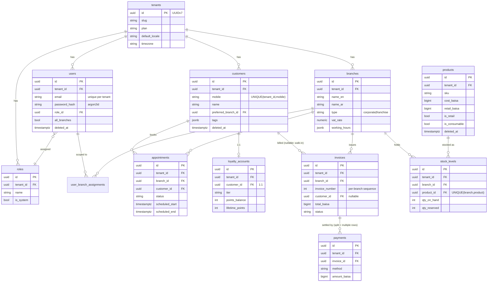

# Keystone HR — Data Model

> One-line summary: The full ~40-table PostgreSQL schema grouped by domain, plus the column conventions (UUIDv7 PKs, BIGINT baisa money, tenant_id + RLS, soft delete) every new table must follow.

`status:` **BUILT** — identity + org tables (`tenants`, `users`, `refresh_tokens`, `roles`, `role_permissions`, `user_branch_assignments`, `branches`, `franchise_details`, `audit_logs`). **PLANNED** — everything else; every table below carries an explicit marker.

Related: [ARCHITECTURE.md](./ARCHITECTURE.md) · [MULTI-TENANCY.md](./MULTI-TENANCY.md) (RLS rules for these tables) · [RBAC.md](./RBAC.md) (how roles/permissions rows are used)

---

## Conventions

Every table follows these rules unless explicitly noted. When adding a table, also run the [new-table checklist in MULTI-TENANCY.md](./MULTI-TENANCY.md#checklist-adding-a-new-tenant-table).

### Primary keys — UUIDv7

All PKs are **UUIDv7** (time-ordered UUIDs): globally unique like UUIDv4, but index-friendly because inserts are roughly sequential (no B-tree page splatter), and they sort by creation time.

### Money — BIGINT minor units + currency code, always

Money is stored as **integer minor units** (`BIGINT`) alongside an ISO 4217 **currency** column. The minor-unit exponent is currency-specific and lives in `CURRENCY_EXPONENTS` in `packages/shared/src/money.ts`: OMR/BHD/KWD → 3 (1 OMR = 1000 baisa), USD/EUR/SAR/AED → 2, JPY → 0. Column names end in `_minor` (early docs/columns may say `_baisa` — same concept, OMR-era naming). Floating point is banned for money.

Worked example — why this matters:

```
Service price:      4.500 OMR  →  4500  minor units (baisa)
5% tax:             4500 * 5 / 100 = 225                 (integer math, exact)
Total:              4725  →  formatted "4.725 OMR" at the display edge

The float version: 4.5 * 1.05 = 4.725000000000001  →  rounding bugs that
compound across invoice lines. With integer minor units, the invariant
sum(lines) + tax − discount === total === sum(payments)
holds exactly and is enforced by property tests (Risk 3 in ARCHITECTURE.md).
```

Rules:
- All arithmetic and formatting goes through the **shared money helpers in `packages/shared`** — never inline math in feature code. Display formatting: [FRONTEND.md](./FRONTEND.md#money--dates).
- **Never mix currencies in one calculation.** Amounts on an invoice are all in the branch's currency; tenant-wide reporting across mixed-currency branches needs explicit conversion (deferred — see GLOBALIZATION.md).
- Currency defaults flow `tenant.default_currency` → `branch.currency` → every financial row records the branch currency at write time.

### Percentages — `numeric(5,2)`

VAT rates, discounts, commission percentages, tier multipliers: `numeric(5,2)` (0.00–999.99). Never float.

### Tenancy + indexes

- Every tenant-owned table has `tenant_id uuid NOT NULL` with the standard RLS policy ([template](./MULTI-TENANCY.md#rls-policy-template)).
- **Composite indexes lead with `tenant_id`**: `(tenant_id, branch_id, scheduled_start)`, `(tenant_id, mobile)`, etc. Since every query filters on tenant first, this makes indexes maximally selective.
- Uniqueness is tenant-scoped: e.g. `UNIQUE(tenant_id, mobile)` on customers, email unique **per tenant** on users.

### Soft delete — deliberately narrow

`deleted_at timestamptz NULL` exists **only** on: `customers`, `services`, `products`, `users` — entities referenced by historical records (invoices, appointments) that must keep resolving after "deletion". Everything else hard-deletes or uses a `status` column. Do not add `deleted_at` to new tables without a matching referential-history reason.

### Timestamps

Every table: `created_at timestamptz NOT NULL DEFAULT now()`, `updated_at timestamptz NOT NULL` (Prisma `@updatedAt`). Domain-time columns (e.g. `occurred_at`, `scheduled_start`) are separate from bookkeeping timestamps. All `timestamptz`; display conversion to Asia/Muscat happens in the frontend.

---

## Core ER diagram

The heart of the model (columns abbreviated; PLANNED tables included to show shape):



---

## Tables by domain

Legend: **[BUILT]** exists in the foundation scaffold · **[PLANNED]** designed, not yet migrated.

### Identity & auth

| Table | Status | Key columns / constraints |
| --- | --- | --- |
| `tenants` | **[BUILT]** | `name`, `slug` (unique), `status`, `plan`, `default_locale`, `timezone`. The tenancy root — the only tenant-scoped-data table *without* a `tenant_id` column (its `id` *is* the tenant id). |
| `users` | **[BUILT]** | `email` **unique per tenant**, `username`, `password_hash` (argon2id), `status`, `locale`, `last_login_at`, `all_branches bool` (branch-scope bypass, see [RBAC.md](./RBAC.md#branch-scoping)), `role_id`, `deleted_at` (soft delete). |
| `refresh_tokens` | **[BUILT]** | `token_hash` (never the raw token), `expires_at`, `revoked_at`, `device_info`. Pruned by a scheduled BullMQ job. |
| `roles` | **[BUILT]** | `name`, `is_system bool`. Tenant-editable; system roles seeded per tenant ([RBAC.md](./RBAC.md#role-model)). |
| `role_permissions` | **[BUILT]** | `role_id`, `permission_key string`. **No `permissions` table** — the key catalog lives in code (`packages/shared/src/permissions.ts` is the source of truth). |
| `user_branch_assignments` | **[BUILT]** | `user_id`, `branch_id` join rows. Ignored when `users.all_branches = true`. |

### Org

| Table | Status | Key columns / constraints |
| --- | --- | --- |
| `branches` | **[BUILT]** | `name_en`/`name_ar`, `type` `corporate\|franchise`, `address`, `phone`, `vat_number`, `vat_rate numeric(5,2)`, `currency`, `status`, `working_hours JSONB`. |
| `franchise_owners` | **[BUILT]** | First-class franchise partner: `owner_name`, `company_name`, `commercial_registration_no` (unique per tenant), `tax_number`, contact, optional `user_id` link to their login. **One owner → many branches.** |
| `franchise_details` | **[BUILT]** | 1:1 with a franchise branch: `franchise_owner_id` FK + per-branch agreement start/expiry dates. The agreement is per location; the owner identity is shared via `franchise_owners`. |

### Customers & catalog

| Table | Status | Key columns / constraints |
| --- | --- | --- |
| `customers` | [PLANNED] | **`UNIQUE(tenant_id, mobile)` — the dedupe rule**; `name`, `email`, `gender`, `dob`, `preferred_branch_id`, `tags JSONB`, `deleted_at`. |
| `service_categories` | **[BUILT]** | `name_en`/`name_ar` (unique per tenant on EN), `sort_order`. |
| `services` | **[BUILT]** | `name_en`/`name_ar`, `duration_minutes`, `buffer_minutes`, `price_minor BIGINT` (geography-neutral naming per GLOBALIZATION — minor units in the tenant currency), `status`, `deleted_at`. |
| `branch_services` | **[BUILT]** | Exception rows only (no row = offered at base price): `price_override_minor BIGINT?`, `is_available`; unique `(service_id, branch_id)`. |
| `service_consumables` | [PLANNED] | service ↔ product mapping with `qty` — drives automatic stock consumption at POS. |

### Appointments

| Table | Status | Key columns / constraints |
| --- | --- | --- |
| `appointments` | [PLANNED] | `branch_id`, `customer_id`, `status` `booked\|confirmed\|checked_in\|in_progress\|completed\|cancelled\|no_show` (state machine), `scheduled_start`/`scheduled_end`, `source`, `notes`. Index `(tenant_id, branch_id, scheduled_start)`. |
| `appointment_services` | [PLANNED] | Line items: `service_id`, `staff_id`, `price_baisa`, per-service time slot. |

### POS

| Table | Status | Key columns / constraints |
| --- | --- | --- |
| `tax_profiles` | **[BUILT]** | Tenant-scoped named tax scheme (e.g. "Oman VAT", "India GST 18%"); `country` hint, `is_default` (inherited by new branches). Seeded at tenant provisioning. See [GLOBALIZATION.md §2](./GLOBALIZATION.md). |
| `tax_components` | **[BUILT]** | `profile_id`, `name` ("VAT"/"CGST"/"SGST"/"IGST"), `rate_percent numeric(5,2)`, `sort_order`. Components apply in parallel to the same base, rounded independently. |
| `invoices` | [PLANNED] | **Per-branch `invoice_number` sequence**; `customer_id` **nullable for walk-in**; `currency`, `subtotal_minor`, `discount_minor`, `loyalty_redeemed_minor`, `tax_minor` + **`tax_breakdown JSONB`** (persisted `TaxLine[]` — the invoice must show what was charged at sale time), `total_minor`; `status` `paid\|partially_paid\|void`; `cashier_id`. |
| `invoice_items` | [PLANNED] | `item_type` `service\|product`, `staff_id` (drives commissions), `qty`, `unit_price_baisa`, line totals in baisa. |
| `payments` | [PLANNED] | `method` `cash\|card\|mada\|bank_transfer\|ewallet`, `amount_baisa`. **Split payment = multiple rows** on one invoice. |

### Inventory & procurement

| Table | Status | Key columns / constraints |
| --- | --- | --- |
| `products` | [PLANNED] | `sku`, `name_en`/`name_ar`, `unit`, `cost_baisa`, `retail_baisa`, `is_retail`, `is_consumable`, `reorder_level`, `deleted_at`. |
| `stock_levels` | [PLANNED] | **`UNIQUE(branch_id, product_id)`**; `qty_on_hand`, `qty_reserved`. Row-locked (`FOR UPDATE`, deterministic order) during POS checkout. |
| `stock_movements` | [PLANNED] | **Append-only ledger** — never updated: `type` `sale\|consumption\|grn_receipt\|transfer_out\|transfer_in\|adjustment\|return`, `qty_delta` (signed), polymorphic `ref` (type + id). `stock_levels` is derivable; movements are the truth. |
| `stock_transfers` + `stock_transfer_items` | [PLANNED] | Branch-to-branch transfers (approvals deferred past MVP). |
| `suppliers` | [PLANNED] | Vendor master. |
| `purchase_requests` + items | [PLANNED — deferred] | MVP uses manual stock adjustments instead of the PR→PO→GRN chain. |
| `purchase_orders` + items | [PLANNED — deferred] | |
| `goods_receipts` + items | [PLANNED — deferred] | GRN receipt writes `stock_movements` of type `grn_receipt`. |

### Loyalty

| Table | Status | Key columns / constraints |
| --- | --- | --- |
| `loyalty_accounts` | [PLANNED] | **1:1 customer**; `tier` `bronze\|silver\|gold\|platinum`, `points_balance`, `lifetime_points` (drives tier). |
| `loyalty_transactions` | [PLANNED] | `type` `earn\|redeem\|expire\|adjust`, `points`, `baisa_value`, `ref_invoice_id`, **`expires_at` on earn rows — expiry is FIFO** (daily job expires oldest unconsumed earns). |
| `loyalty_earn_rules` | [PLANNED] | `baisa_per_point`, tier thresholds/multipliers, `expiry_months`. |
| `promotions` | [PLANNED] | MVP: percent/fixed discount codes only. |

### Staff & commissions

| Table | Status | Key columns / constraints |
| --- | --- | --- |
| `staff_profiles` | **[BUILT]** | 1:1 with `users`: `employment_type`, `joining_date`, `base_salary_minor`, branch, gender — populated by the Staff wizard and read throughout Payroll. |
| `staff_schedules` | [PLANNED] | `weekday`/`start`/`end` — **drives appointment availability**. |
| `commission_rules` | [PLANNED] | Percentage (`numeric(5,2)`) or fixed-baisa rules per staff/service. |
| `commission_records` | [PLANNED] | Written inside the POS checkout transaction per serving staff member. |

### Attendance & Leave

See `docs/MODULES/attendance.md` and `docs/MODULES/leave.md` for the full spec and resolved design
decisions.

| Table | Status | Key columns / constraints |
| --- | --- | --- |
| `attendance_days` | **[BUILT]** | One per staff per calendar day; `status`, `first_in_at`/`last_out_at`, `total_worked_minutes`; **`UNIQUE(tenant_id, staff_profile_id, date)`**. |
| `attendance_sessions` | **[BUILT]** | One per check-in/check-out punch pair within a day; `check_in_at`/`check_out_at`, `source` (self vs. manual entry). |
| `leave_types` | **[BUILT]** | Tenant-configurable catalog (`Settings > Leave Settings`): `is_paid`, `days_per_year`, `count_mode`, `credit_policy`, `allow_half_day`, `require_supporting_document`, `requires_second_approval`, `allow_negative_balance`. |
| `leave_balances` | **[BUILT]** | Per staff, per leave type, per year: `opening_balance`, `accrued`, `used`, `carried_forward` — credited by a nightly accrual job. |
| `leave_requests` | **[BUILT]** | `start_date`/`end_date` (+ half-day flags), `status`, optional `attachment_key`; approval flow supports a configurable second-level step. |

### Payroll

See `docs/MODULES/payroll.md` for the full spec, resolved design decisions, and the
v1-deferred Commission/Absence Deduction scope note.

| Table | Status | Key columns / constraints |
| --- | --- | --- |
| `payroll_runs` | **[BUILT]** | One per branch + month; **`UNIQUE(tenant_id, branch_id, payroll_month)`** — idempotent generation. |
| `payroll_items` | **[BUILT]** | One per staff per run; locked `base_salary_minor` snapshot + editable override totals (`allowances_total_minor`, `statutory_deductions_total_minor`, `other_deduction_minor`) + derived `net_pay_minor`; `status` `pending\|approved\|rejected\|paid`. |
| `payroll_item_components` | **[BUILT]** | Read-only snapshot of the staff member's configured allowance/deduction components at generation time (payslip breakdown display only). |
| `payroll_item_adjustments` | **[BUILT]** | Ad-hoc addition/deduction rows added during edit (bonus/overtime, advance/fine). |
| `payroll_action_batches` | **[BUILT]** | One row per approve/reject action (individual or bulk); `batch_no` sequential per run — powers the payroll listing's Batch view. |

### Finance

| Table | Status | Key columns / constraints |
| --- | --- | --- |
| `finance_transactions` | [PLANNED] | Unified simple ledger: `direction` `in\|out`, `category` `sale_revenue\|expense\|supplier_payment\|payroll\|refund\|other`, `amount_baisa`, `method`, polymorphic `ref`, `occurred_at`. **P&L is a query, not a table.** Payroll's Mark Paid action does not yet write here — see `docs/MODULES/payroll.md`. |
| `expenses` | [PLANNED] | Manual expense entry; mirrors into `finance_transactions`. |

### Cross-cutting

| Table | Status | Key columns / constraints |
| --- | --- | --- |
| `audit_logs` | **[BUILT]** | `action`, `entity` (type + id), `before`/`after JSONB`, `ip`. **Partitioned by month**, 24-month retention. Written by the audit interceptor + explicit `auditService.log()` in sensitive transactions. |
| `notifications` | [PLANNED] | Delivery log: `channel` `sms\|email\|whatsapp`, `template_key`, `payload JSONB`, `status`. Every send is a BullMQ job. |
| `tenant_settings` | [PLANNED] | Key/value JSONB per tenant (e.g. digit-display preference). |

---

## Count check

Identity 6 + Org 2 + Customers/catalog 5 + Appointments 2 + POS 3 + Inventory 12 (incl. item tables) + Loyalty 4 + Staff 4 + Attendance/Leave 5 + Payroll 5 + Finance 2 + Cross-cutting 3 ≈ **53 tables** — "~40" as originally designed, grown with the 2026 requirement refresh (Payroll, Attendance, Leave).
