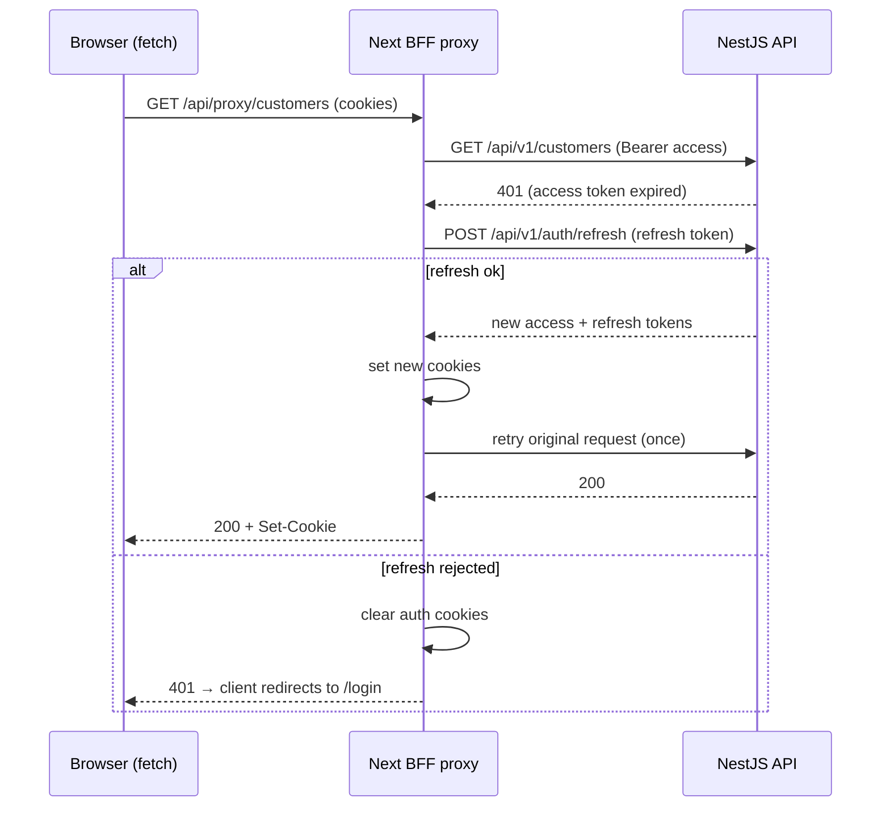

# Keystone HR — Frontend (apps/web)

> One-line summary: Next.js 15 App Router with a `[locale]` segment (EN + AR RTL enforced by logical-properties lint), httpOnly-cookie BFF auth, server components for shell + TanStack Query for interactive screens, shadcn/ui, and shared zod/money helpers from `packages/shared`.

`status:` **BUILT** — web shell: `[locale]` routing, next-intl, RTL + lint, BFF proxy/login/refresh, middleware guard, Tailwind 4 + shadcn/ui base, providers. **PLANNED** — feature screens (wizard, POS cart, dashboards), shared DataTable, Recharts dashboards (each lands with its API module).

Related: [ARCHITECTURE.md](./ARCHITECTURE.md) · [API-CONVENTIONS.md](./API-CONVENTIONS.md) (envelopes/errors this app consumes) · [RBAC.md](./RBAC.md) (permission constants used to hide UI)

---

## App Router structure

```
apps/web/app/
├── [locale]/                      # 'en' | 'ar' — every page lives under this
│   ├── (auth)/                    # public group: no shell
│   │   └── login/page.tsx
│   ├── (dashboard)/               # authenticated group: sidebar/topbar shell layout
│   │   ├── layout.tsx             #   server component; loads user/nav
│   │   ├── page.tsx               #   dashboard KPIs
│   │   ├── branches/              #   [BUILT]
│   │   ├── customers/ appointments/ pos/ inventory/ ...   [PLANNED]
│   │   └── settings/
│   └── layout.tsx                 # sets <html lang dir> + NextIntlClientProvider
├── api/
│   ├── proxy/[...path]/route.ts   # BFF proxy → NestJS (Bearer from cookies)
│   └── auth/                      # login/logout/refresh route handlers (set cookies)
└── middleware.ts                  # next-intl locale routing + cookie-presence guard
```

- Route **groups** `(auth)` / `(dashboard)` separate the public and shelled layouts without affecting URLs.
- `middleware.ts` redirects unauthenticated visits to dashboard routes to login based on **cookie presence only** — a UX convenience. **Real authorization is always the API's job** (guards, [RBAC.md](./RBAC.md#guard-chain)).

## i18n — next-intl

**next-intl 3.x** with the `[locale]` segment (`en`, `ar`). The root layout resolves messages server-side and sets `<html lang={locale} dir={locale === 'ar' ? 'rtl' : 'ltr'}>`.

### Adding a string — the only allowed workflow

1. Add the key to **both** `messages/en.json` **and** `messages/ar.json` (same PR; CI compares key sets and fails on drift).
2. Use it: `const t = useTranslations('branches'); t('createTitle')` (or `getTranslations` in server components).
3. **Never hardcode user-visible text.** Not in JSX, not in toasts, not in `aria-label`s, not in zod messages surfaced to users. API error codes map to localized messages here too ([API-CONVENTIONS.md](./API-CONVENTIONS.md#errors)).

Keys are namespaced by module (`branches.form.nameAr`). Missing-key behavior is a build/CI error, not a silent English fallback.

## RTL rules

<a id="rtl-rules"></a>

Arabic is a first-class layout, not a mirrored afterthought (Risk 4 in [ARCHITECTURE.md](./ARCHITECTURE.md#7-risk-register)). `dir="rtl"` on `<html>` flips the document; our job is to never write CSS that fights it.

### Tailwind: LOGICAL PROPERTIES ONLY

| Banned (physical) | Required (logical) | Meaning |
| --- | --- | --- |
| `ml-*` | `ms-*` | margin-inline-start |
| `mr-*` | `me-*` | margin-inline-end |
| `pl-*` | `ps-*` | padding-inline-start |
| `pr-*` | `pe-*` | padding-inline-end |
| `left-*` | `start-*` | inset-inline-start |
| `right-*` | `end-*` | inset-inline-end |
| `text-left` | `text-start` | |
| `text-right` | `text-end` | |
| `border-l-*` / `border-r-*` | `border-s-*` / `border-e-*` | |
| `rounded-l-*` / `rounded-r-*` | `rounded-s-*` / `rounded-e-*` | |

### The lint check

A CI/pre-commit script greps `apps/web` for banned physical utilities (also wired as an ESLint rule so violations surface in-editor):

```bash
# scripts/check-rtl.sh — fails the build on any physical direction class
grep -rnE '\b(ml|mr|pl|pr)-|\btext-(left|right)\b|\b(left|right)-[0-9]|border-[lr]-|rounded-[lr]-' \
  apps/web --include='*.tsx' --include='*.ts' && exit 1 || exit 0
```

Enforced since the first component — there is no physical-property backlog to migrate.

Additional RTL rules:

- Directional icons (chevrons, arrows, "back") must flip: `rtl:rotate-180` or logical icon pairs.
- shadcn/ui is built on Radix, which **respects `dir`** — one reason it was chosen.
- **Review-in-Arabic rule:** every new screen is reviewed under `/ar` before merge — switch locale, check alignment, truncation, icon direction, number rendering. RTL bugs found in review are cheap; found in production they're a retrofit.

## BFF auth

<a id="bff-auth"></a>

The browser **never holds tokens in JavaScript**. It talks only to the Next.js origin; tokens live in **httpOnly, Secure, SameSite=Lax cookies**.

- **Login:** form posts to the Next route handler → it calls the NestJS API → on success sets `access_token` + `refresh_token` cookies. XSS cannot read them.
- **Every API call** goes through `app/api/proxy/[...path]/route.ts`, which reads the cookie and forwards to NestJS with `Authorization: Bearer <jwt>`.
- **Refresh-on-401, retry once:**



Exactly **one** retry — a second 401 is a real auth failure, never a retry loop.

- **Why mobile bypasses the BFF:** cookies + proxy exist purely to keep tokens out of *browser* JS (XSS defense). A native app has secure storage (Keychain/Keystore), no XSS surface, and no Next origin — it stores tokens itself and calls the API directly with Bearer headers, using the generated `packages/api-client` ([API-CONVENTIONS.md](./API-CONVENTIONS.md#openapi--the-future-mobile-client)).

## Data fetching

Two modes, chosen by interactivity, not fashion:

| Use | Mechanism |
| --- | --- |
| Shell, layouts, first paint of mostly-static pages, user/nav data | **React Server Components** — fetch on the server, zero client JS |
| Anything interactive: booking wizard, POS cart, dashboards, filterable tables | **Client components + TanStack Query v5** through the BFF proxy |

Conventions:

- Query keys: `['customers', { page, pageSize, sort, ...filters }]` — mirror the API params so invalidation is mechanical.
- Mutations invalidate their list keys; POS checkout sends the `Idempotency-Key` header ([API-CONVENTIONS.md](./API-CONVENTIONS.md#idempotency--pos--payments-planned-phase-4)).
- **Dashboards: `refetchInterval: 60_000`** (60 s) — the locked freshness decision. **No websockets in v1.**
- List responses are the `{ data, meta }` envelope; the shared DataTable consumes `meta.total` for server pagination.

## Component conventions

<a id="component-conventions"></a>

- **shadcn/ui, copy-in model:** components are generated into `apps/web/components/ui/` and owned/edited by us — it's not an npm dependency to fight. Radix underneath handles focus, a11y, and `dir`.
- Charts: **Recharts**.
- **Shared DataTable** (TanStack Table v8) — one component contract for every list screen [PLANNED, lands with Catalog/Customers]:
  - **Server pagination** driven by `{ data, meta }` (`page`/`pageSize`/`sort` state → query params; max pageSize 100).
  - Column defs supply header i18n keys and cell renderers (money/date cells use the shared helpers below).
  - Built-in **export button** posting current filters to the sibling `POST /export` endpoint and handling sync-download vs job-polling ([API-CONVENTIONS.md](./API-CONVENTIONS.md#exports-planned-phase-6)).
  - Row-action visibility driven by `PERMISSIONS` constants from `packages/shared` (UI hiding is convenience; API enforces).

## Forms

<a id="forms"></a>

**react-hook-form + `@hookform/resolvers/zod`**, resolving the **same schema the API validates with** — from `packages/shared`, never redefined locally:

```tsx
import { createBranchSchema, type CreateBranchInput } from '@hayryou/shared';

const form = useForm<CreateBranchInput>({
  resolver: zodResolver(createBranchSchema),
});
// Client-side validation === server-side validation, by construction.
// Server-only failures (e.g. CUSTOMER_MOBILE_EXISTS) map error code →
// localized message → form.setError on the matching field.
```

## Money & dates

<a id="money--dates"></a>

- **Money:** values arrive from the API as **integer baisa** ([DATA-MODEL.md](./DATA-MODEL.md#conventions)). All arithmetic and formatting via the **shared money helpers** in `packages/shared` — never inline `/1000` or `toFixed`:

```ts
formatOMR(4725n /* baisa */, locale)
// under the hood: Intl.NumberFormat(locale, { style: 'currency',
//   currency: 'OMR', minimumFractionDigits: 3 })  → "OMR 4.725"
```

- **Digits:** keep **Western (Latin) digits in financial contexts** even under `ar` (`numberingSystem: 'latn'`) — invoices, POS, reports must match printed receipts and bank statements. Eastern Arabic digits may become a tenant setting later; the helper owns that decision, callers don't.
- **Dates:** **date-fns + @date-fns/tz** pinned to **Asia/Muscat** for all business-time display and grouping ("today's appointments" = Muscat's today, whatever the DB/server timezone says). API timestamps are `timestamptz`; conversion happens only at display. Locale-aware formatting via date-fns AR/EN locales through a shared `formatDate` helper.
