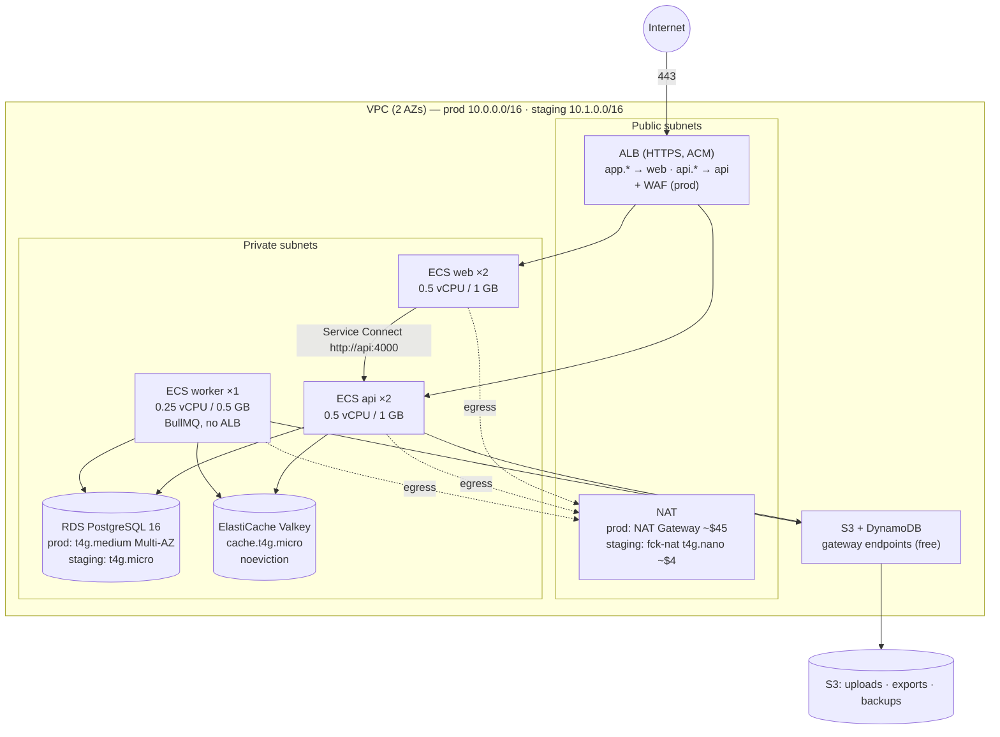

# Keystone HR — AWS Infrastructure Design

> **status: designed, not yet applied — no AWS accounts provisioned.**
> Terraform lives in `infra/` (see `infra/README-bootstrap.md` for the one-time
> setup and `infra/CLAUDE.md` for working conventions). This document is the
> rationale; the code is the spec.

**Context.** Small team (2–4 devs, no dedicated DevOps). Next.js + NestJS
monorepo, Dockerized. PostgreSQL with row-level security (RLS), Redis/BullMQ,
S3. ECS Fargate at launch, EKS later — designed so the move is configuration,
not a rewrite. Philosophy: **boring, managed, cheap, reversible**.

---

## 1. Region: me-central-1 (UAE)

| Consideration | me-central-1 | eu-central-1 (fallback) |
|---|---|---|
| Latency from Muscat | ~10–20 ms | ~130 ms |
| Data residency | GCC-hosted — a sales point under Oman PDPL | EU-hosted |
| Price | ~15–25% higher | baseline |
| Feature availability | Lags newer services — verify before assuming | Full |
| SES | Confirmed available | Available |

Decision: **me-central-1 primary**. The latency and data-residency wins are
worth the ~20% premium at this bill size (~$80/mo of premium on ~$470).

Mitigations for the feature-lag risk:
- Region is a **single Terraform variable**; zero hardcoded ARNs or regions in
  modules (data sources resolve region/account). Falling back to eu-central-1
  is a tfvars change.
- **Week-1 smoke check** (in bootstrap doc): Fargate Graviton, Service Connect,
  RDS PG16 on t4g, ElastiCache Valkey, WAFv2, SES sending — verified in-region
  before anything depends on them.

## 2. Environments & accounts

- **local** — docker-compose (postgres:16, redis:7, minio, mailpit). All
  day-to-day development happens here. No cloud dev environment, no PR preview
  environments.
- **staging** — auto-deploys from `main`.
- **prod** — deploys on tag `v*` behind a manual approval.

AWS Organizations with **three accounts**, no Control Tower:

| Account | Purpose |
|---|---|
| management | Billing, Identity Center (SSO), org CloudTrail, budgets. No workloads. |
| workloads-nonprod | Staging + ECR (single source of images) |
| workloads-prod | Prod. Pulls promoted images from nonprod ECR. |

**No IAM users anywhere.** Humans authenticate via Identity Center SSO; CI via
GitHub OIDC with per-account roles.

## 3. Network

Per environment: a VPC (prod `10.0.0.0/16`, staging `10.1.0.0/16`), 2 AZs,
public subnets (ALB, NAT) and private subnets (tasks, RDS, Redis).

- **NAT**: prod uses one managed NAT Gateway in a single AZ (~$45/mo, accepted
  availability trade-off); staging uses a fck-nat t4g.nano instance (~$4/mo).
- **Free S3/DynamoDB gateway endpoints from day one** — ECR image layers come
  from S3, so this kills the biggest hidden NAT cost. Interface endpoints only
  when a service's NAT data charge exceeds the ~$7/mo endpoint cost.
- Keep images small (alpine, multi-stage, Next standalone output) — ECR pulls
  through NAT are the hidden cost.

**Security group chain** (each hop only admits the previous):
`world →443→ ALB SG → tasks SG → RDS SG (5432) / Redis SG (6379)`.
No SSH anywhere; shells via ECS Exec (IAM-gated, audited).

## 4. Compute

One ECS cluster per env, three Fargate services:

| Service | Prod size | Prod scale | Staging | ALB | Notes |
|---|---|---|---|---|---|
| web (Next.js, :3000) | 0.5 vCPU / 1 GB | 2–6, CPU 60% | 1× 0.25/0.5 | app.hayryou.com | |
| api (NestJS, :4000) | 0.5 vCPU / 1 GB | 2–6, CPU 60% | 1× 0.25/0.5 | api.hayryou.com | Service Connect name `api` |
| worker (BullMQ) | 0.25 vCPU / 0.5 GB | 1–3, CPU 60% | 1× 0.25/0.5 | none | **same image as api, different CMD** |

- One ALB, HTTPS only (ACM), host-based routing. Default action 404.
- **ECS Service Connect** namespace `hayryou.local`: web calls
  `http://api:4000` — exactly the name shape a K8s Service will have later.
- Rolling deploys with the **deployment circuit breaker** (auto-rollback),
  min healthy 100% / max 200%. Not CodeDeploy blue/green — unneeded complexity
  at this scale.
- Multi-arch images (buildx amd64+arm64); switch tasks to Graviton (ARM64) once
  confirmed in-region.

## 5. Data

### PostgreSQL — RDS, not Aurora

Prod: **db.t4g.medium, Multi-AZ, gp3 50 GB** (Multi-AZ from day one — the best
$60 in this design: it converts an AZ or instance failure from an incident into
a footnote). Staging: db.t4g.micro single-AZ. Both: encryption, deletion
protection, Performance Insights (free tier), **14-day automated backups/PITR**
plus a nightly `pg_dump` ECS scheduled task to the backups bucket.

### Why no RDS Proxy (deliberate, load-bearing)

Our tenant isolation is PostgreSQL RLS driven by
`SET LOCAL app.tenant_id = …` per transaction. RDS Proxy **pins** a client
connection to a backend connection the moment it sees session state (`SET`),
which defeats the multiplexing that is the proxy's entire value — we'd pay for
a proxy that degrades to pass-through. And we don't have the problem it solves:
≤9 tasks × ~10 pooled connections ≈ 90, versus ~400 `max_connections` on
t4g.medium. The rule that actually matters is app-side: **`SET LOCAL` and its
queries must share one connection inside one transaction** — enforced by a
transaction-wrapper helper and cross-tenant CI tests.

### Redis — ElastiCache Valkey

cache.t4g.micro, **single node**, both envs. Parameter group sets
`maxmemory-policy=noeviction` — BullMQ state corrupts under eviction; running
out of memory loudly beats silently dropping jobs. No replica: jobs are
idempotent and re-enqueueable by design, so a node loss costs minutes of
re-enqueueing, not correctness.

## 6. Storage

Per-purpose buckets, all Block Public Access (bucket + account level), SSE:

| Bucket | Purpose | Lifecycle |
|---|---|---|
| `hayryou-{env}-uploads` | Tenant files via presigned PUT/GET, keys `tenants/{tenant_id}/…` | Versioned; Intelligent-Tiering after 30 d |
| `hayryou-{env}-exports` | Generated reports | Expire 90 d |
| `hayryou-{env}-backups` | Nightly pg_dump | Glacier IR after 30 d, delete 365 d |

Tenant isolation in S3 is enforced at the **app layer** (presign only after a
tenant check), not with per-tenant IAM — IAM policies per tenant don't scale
and RLS is already the isolation boundary.

## 7. IaC: Terraform

- **Terraform (OpenTofu-compatible HCL)**, not CDK (CloudFormation stuck-stacks;
  the EKS future lives in the Terraform ecosystem — terraform-aws-modules/eks),
  not SST (container-first app, not lambda-first).
- Layout: `infra/modules/{network,cluster,service,data,storage,cicd,alb}` +
  `infra/envs/{staging,prod}` — **directories, not workspaces**; separate state
  per account. (`infra/global` for org-level things when codified.)
- State: S3 backend per account with the native lockfile (TF ≥ 1.10).
- **Humans plan/apply locally via SSO; CI only plans** on `infra/**` PRs.
- **Task-definition image tags live outside Terraform** (`ignore_changes`):
  CI-driven app deploys and Terraform applies never fight.
- The `service` module's inputs are shaped like Helm values on purpose — it is
  the future chart.

## 8. CI/CD: GitHub Actions

OIDC → IAM role per account; the prod role's trust is pinned to
`environment:production`, so GitHub's required-reviewer gate is enforced by IAM.
ECR lives in nonprod; prod pulls via repository policy — **images are promoted,
never rebuilt**.

- **PR**: install (pnpm cache) → lint → typecheck → unit → integration against
  service containers (postgres, redis) **including RLS cross-tenant tests** →
  docker build check → `terraform plan` if `infra/**` changed.
- **main → staging**: buildx (GHA layer cache), tag `sha-<gitsha>`, push ECR →
  **migration as a one-off ECS run-task** (`prisma migrate deploy`; poll; abort
  the deploy on failure) → `ecs update-service` api/worker/web → wait stable →
  smoke test `/healthz` + an authenticated round-trip.
- **tag v\* → prod**: same, reusing the staging-validated image **digest**,
  behind the GitHub Environment approval.
- Migration discipline: **expand → migrate → contract**; never in app startup;
  never from laptops; staging rehearses every migration automatically.

## 9. Secrets & config

- **Secrets Manager**: RDS master credentials (managed rotation) + third-party
  API keys (~$3/mo). **SSM Parameter Store (free)** for everything else.
  Naming: `/hayryou/{env}/{service}/KEY`.
- Delivery: native ECS taskdef `secrets` injection → env vars. The app only
  ever reads `process.env` (12-factor — maps directly to K8s Secrets later).
  A config change is a new taskdef revision, redeployed like code.
- Secret values never appear in Terraform code or state.

## 10. Observability

- **Logs**: Pino JSON → stdout → awslogs → CloudWatch, 30-day retention (set
  explicitly). Logs Insights for queries. No ELK.
- **Errors**: Sentry in both apps (~$26/mo or free tier), `release` = git SHA.
- **Alarms** → SNS → email/Slack: ALB 5XX rate, p95 latency > 1.5 s,
  `running < desired` per service (catches crash loops, including the worker,
  which has no ALB health check), RDS CPU > 80% / storage < 20% /
  connections > 300, Redis memory > 80%, BullMQ failed-jobs custom metric.
- One CloudWatch dashboard per env. External uptime: UptimeRobot/BetterStack
  free tier on `/api/health`.
- **Tracing: skipped for now.** When needed, OpenTelemetry — not the X-Ray SDK
  (vendor lock the design explicitly avoids).

## 11. Messaging (Oman/GCC) — regulatory lead times, start early

| Channel | Choice | Lead time |
|---|---|---|
| Email | SES me-central-1; domain identity + DKIM/SPF/DMARC day one; bounce/complaint SNS handler | Production access: **days** — request at bootstrap |
| SMS | **Unifonic** (GCC-native, Oman-strong; Twilio as alternative). Not SNS — GCC sender-ID/deliverability is poor | Omantel/Ooredoo sender-ID registration: **weeks of paperwork — start months before launch** |
| WhatsApp | The channel GCC customers actually read. Via a Meta BSP — Unifonic is one, so one vendor covers both channels | Business verification + template pre-approval: **weeks** |

Code shape: a `NotificationChannel` interface with per-provider adapters; every
send is a BullMQ job with retry; provider webhooks update delivery status. No
multi-provider failover or template CMS now.

## 12. Security baseline

- **WAF on the ALB at launch** (~$15/mo): AWSManagedRulesCommonRuleSet,
  KnownBadInputs, rate rule 2000 req/5 min/IP. **Count mode for the first
  week**, then block.
- SG chain as in §3; no SSH; ECS Exec for shells (audited).
- ECR: scan-on-push, **immutable tags**, keep last 20.
- IAM: task role per service (least privilege, no `*` on data access); one
  shared execution role per env scoped to `/hayryou/{env}/*` config; CI via
  OIDC only; humans via SSO only.
- Org CloudTrail; IAM Access Analyzer; GuardDuty on prod; AWS Budgets at
  50/80/100% + anomaly detection in week 1.

## 13. EKS migration path

**Do now (all already in the Terraform/app design):**
- 12-factor strictly: env-only config, stdout logs, no disk state, SIGTERM
  draining (`initProcessEnabled` + `stopTimeout` in the taskdef).
- `/healthz` + `/ready` on every service.
- One image per service with **CMD as a variable** (worker = api image + CMD).
- Multi-arch builds, non-root numeric UID.
- `service` module inputs ≈ Helm values; Service Connect DNS names ≈ K8s
  Service names; RDS/Redis/S3/SES stay **outside** the cluster concept.

**Don't build now:** Helm charts, a service mesh, or a "toy" EKS cluster to
practice on. Each is premature; none is required for the later move.

## 14. Cost (monthly, rough, me-central-1)

| Item | Prod | Staging |
|---|---:|---:|
| Fargate (2×web, 2×api, 1×worker / 1× each) | ~$95 | ~$25 |
| RDS PostgreSQL (t4g.medium Multi-AZ / t4g.micro) | ~$135 | ~$15 |
| ElastiCache (cache.t4g.micro) | ~$14 | ~$14 |
| ALB | ~$27 | ~$25 |
| NAT (Gateway / fck-nat) | ~$45 | ~$4 |
| WAF | ~$15 | — |
| S3 + ECR | ~$8 | ~$5 |
| CloudWatch | ~$15 | ~$10 |
| Secrets Manager | ~$3 | ~$2 |
| Misc (data transfer, Route 53, …) | ~$15 | ~$10 |
| **Subtotal** | **~$360** | **~$110** |

**Total ≈ $470/mo** + Sentry $26. Levers: scheduled staging shutdown
(−$25), Fargate Compute Savings Plan after 3 months of stable usage (−15–20%).

## 15. Risks

1. **me-central-1 feature lag** — week-1 smoke test; region is a variable;
   eu-central-1 fallback is a tfvars change.
2. **RLS + pooling correctness** — the transaction wrapper (`SET LOCAL` +
   queries on one connection) is mandatory; cross-tenant tests in CI on every
   PR. This is the highest-severity risk in the system: a miss is a data leak
   between salons.
3. **NAT + ECR cost creep** — small images, gateway endpoints day one, watch
   NAT `BytesProcessed`.
4. **Migration/deploy coupling** — expand→migrate→contract in the PR checklist
   from commit #1; staging rehearses every migration.
5. **GCC messaging is regulatory, not technical** — Unifonic onboarding,
   sender-ID registration, and WhatsApp verification start months before
   launch; there is no engineering workaround for paperwork.
