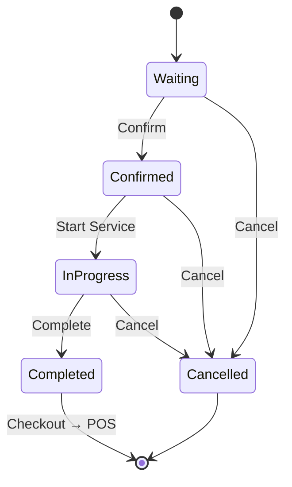

# Appointments

```
status: built — Calendar/Kanban/List views, the 4-step booking wizard, status-transition
actions (Confirm/Start/Complete/Cancel), and Edit (barber/services/schedule, reusing the same
wizard) are live (apps/web/.../appointments); permission gating confirmed correct end-to-end.
Add/View/Edit all share one slide-in Drawer (not a modal), matching the Customers/Walk-in
Queue pattern — see §5/§6. Calendar/Kanban/List all show the same status Badge (dot + colored
pill); the List row action is an Eye icon, not a text link. The page header carries a subtitle
and, in Calendar view, the Day/Week/Month mode switch (between the view switcher and New
Appointment); the filter row is right-aligned with either the Calendar date nav (Previous/
Today/Next + period label) or, for List/Kanban, a date-range picker defaulting to today —
List/Kanban are now date-scoped by default rather than all-time (Kanban was previously capped
at a silent 100-record fetch with no date bound at all). Kanban supports dragging a card onto
another status column (`@dnd-kit/core`) to move it, reusing the exact same permission/transition
rules as the Details drawer's action buttons; invalid drop targets are visually disabled while
dragging. Full feature-parity audit against the req below is separate from this status line —
see each section for what's confirmed vs. still open.
```

## Purpose

Book, view, and manage all customer appointments across a salon chain. The 2026 requirement
reframes the module around a single **Appointments Dashboard** with three interchangeable views
(Calendar / Kanban / List) and a streamlined **four-step booking wizard**
(Services → Barber → Date & Time → Confirm). Completed appointments hand off to POS/Checkout.
Bilingual EN + AR (RTL); currency OMR with 3 decimals (baisa), stored as integer minor units.

## Primary users / permissions

Receptionists (primary), Branch Managers, Operations/Management, Super Admin. Branch-scoped roles
see appointments for their assigned branches only (`@BranchScoped`, `getEffectiveBranchIds()`).
The dashboard always operates within one **currently selected branch**; all three views are scoped
to that branch.

## Screens & flows

### 1. Appointments Dashboard

The primary screen. On open the system:
- displays appointments for the selected date,
- loads the default appointment view,
- displays the currently selected branch,
- loads available appointment records,
- shows appointment info according to the selected view.

The page header carries a one-line subtitle under the "Appointments" title (matching the
Staff/Payroll title+subtitle pattern).

**View switcher** — three interchangeable views over the *same* underlying data; switching changes
only the presentation, never the data:
- Calendar View
- Kanban View
- List View

A **New Appointment** action (present on Kanban and List headers; opens the wizard) is available;
after save every view refreshes automatically and shows the new record.

> ⚠️ The 2026 req contains **no KPI-card row** on the dashboard (the old doc had 6 KPI cards). See
> Open questions.

### 2. Calendar View

Graphical, time-based view of scheduled appointments for the selected branch. Three display modes;
data is identical across modes, only presentation changes.

**Calendar Header**
- **Branch Selection** — shows current branch; changing it refreshes the calendar to that branch only.
- **View indicator** — shows "Calendar View"; user may switch to Kanban / List without affecting data.
- **Calendar Mode** — Day | Week | Month; lives in the page header (between the Calendar/Kanban/List
  switcher and New Appointment), shown only while Calendar view is active; changing mode updates
  presentation only.
- **Date Navigation** — Previous | Current Date | Next + the period label; lives right-aligned in the
  shared filter row (not inside the calendar body); selecting refreshes to that period.

**Display modes**
- **Day View** — a resource grid: one column per barber (X axis, from `/appointments/barbers`) × fixed
  30-min time-slot rows (Y axis, derived from the selected branch's `workingHours.openingTime`/
  `closingTime`). Each appointment is placed at its barber's column, starting row = its scheduled
  start time, row-span = `ceil(durationMinutes / 30)`. Card color is uniform (not yet per-barber —
  deferred); status shows as a colored dot + label (see Appointment Card below). Overlapping
  appointments for the same barber lay out as side-by-side column slices (standard calendar
  column-packing), not stacked. Built beyond the original spec's plain chronological list, matching
  an approved design mockup.
- **Week View** — seven consecutive days; each day shows its appointments; broader workload overview.
- **Month View** — whole month; each date indicates appointments booked that day; selecting a date
  reviews that day's appointments. Used for planning / spotting booking trends. Its per-day mini-list
  keeps the bare status dot (no label) — too narrow to fit one without truncating the customer name.

**Auto-refresh triggers**: calendar mode change, displayed date change, branch change, a new
appointment is created, an appointment is modified.

**Appointment Card** (summary, no need to open detail): Appointment Number, Customer Name,
Service(s) (all shown if multiple), Assigned Staff (Barber), Appointment Time, Appointment Status
(colored dot + translated label, not just the dot).

**Open detail**: selecting a card opens the **Appointment Details** drawer.

### 3. Kanban View

Status-based board for the selected branch. Instead of time, appointments are grouped into columns by
current status, for monitoring customer flow and identifying items needing attention.

**Kanban Header**
- **Branch Selection** — as Calendar; changing branch refreshes the board.
- **View indicator** — "Kanban View"; switch to Calendar / List without changing data.
- **Search** — filters the cards on the board; may search Appointment Number, Customer Name,
  Mobile Number, Service, Staff. Clearing search restores all cards.
- **Date range** — right-aligned in the filter row, defaulting to today; narrows the board to that
  range (previously Kanban had no date bound at all and silently capped at 100 records — now
  date-scoped by default, same picker as List).
- **New Appointment** — opens the wizard; on save the board refreshes and the card appears in the
  correct status column.

**Status Columns** — one column per configured status; a card appears in the column matching its
current status; each appointment is in exactly one column at a time. Columns as defined in the
prototype (5 statuses — see Status machine): Waiting / Upcoming, Confirmed, In Progress, Completed,
Cancelled.

**Appointment Card**: Appointment Number (e.g. `APT-2026-001245`), Customer Name, Services (all shown
if multiple), Assigned Staff (Barber), Appointment Time, Appointment Status (matches its column).
Selecting a card opens the **Appointment Details** drawer.

**Drag-and-drop status moves** (built beyond the original req): a card can be dragged from its
column onto another status column to move it, using `@dnd-kit/core` (the app's first drag-and-drop
feature). A drop only succeeds if the target is a valid transition per the status machine (§ Status
machine) AND the user holds the matching permission (`appointments.update`/`.checkin`/`.cancel`,
the same `ACTION_BY_STATUS` mapping the Details drawer's action buttons use) — invalid columns
visually dim/disable while dragging, and a rejected drop (e.g. a stale/expired transition) shows a
toast rather than silently failing. Keyboard-draggable via `@dnd-kit`'s keyboard sensor.

### 4. List View

Structured tabular view of appointment records for the selected branch; best for locating appointments
and handling large volumes.

**List Header**
- **Branch Selection** — as above; changing branch refreshes the list.
- **View indicator** — "List View"; switch to Calendar / Kanban without affecting data.
- **Search** — dynamic; by Appointment Number, Customer Name, Mobile Number, Service, Staff.
- **Filter** — applying refreshes to matching records; removing restores full list.
- **Date range** — right-aligned in the filter row, a two-field date picker (native `<input
  type="date">`, no calendar-popover library in this app) defaulting to today; previously List had
  no date bound at all (all-time, paginated).
- **New Appointment** — opens the wizard; list refreshes and shows the new record after save.

**Table columns** (one appointment per row):
1. Appointment Number — unique reference; uniquely identifies each appointment
2. Customer
3. Services — all shown if multiple
4. Staff — assigned barber
5. Appointment Date
6. Appointment Time
7. Status
8. Actions — an Eye icon (not a text link, matching Staff/Branches/Walk-in Queue's row-action
   convention) opens the **Appointment Details** drawer

Search/filter criteria persist until changed or cleared. Search and filter affect displayed records
only; they never modify data.

> ⚠️ The 2026 List View **drops** the old Amount, Payment Status columns and the Export
> (Excel/PDF/CSV) control. See Open questions.

### 5. New Appointment wizard (4 steps)

A guided wizard; each step collects only what that stage needs. The appointment is created **only**
after all four steps complete and Confirm. **Close** on any step exits without saving.

The same component also drives **Edit** (§6): Steps 1–3 behave identically, pre-filled from the
appointment being edited; Step 4 drops the Mobile/Name customer fields (shows the existing customer
read-only instead) and the final button reads "Save Changes" instead of "Book Appointment".

```
Step 1 Services → Step 2 Barber → Step 3 Date & Time → Step 4 Confirm → Create Appointment
```

A step progress indicator (Services · Barber · Date & Time · Confirm) highlights the current step on
every step.

#### Step 1 — Services
- **Service cards**: each shows Service Name, Duration (informational, configured per service),
  Price (OMR). Example: `Haircut + Beard · 45 min · OMR 8.500`.
- Selecting a card highlights it and adds it to the appointment; **multiple services** may be selected.
- **Total** — sum of selected service prices; updates automatically on select/deselect.
- **Next** requires ≥ 1 service (block + prompt otherwise); carries selected services to Barber.
- **Close** exits without creating an appointment.

#### Step 2 — Barber
Displays all barbers for the selected branch as selectable **profile cards**; select exactly one.

**Barber card**: Avatar (coloured, barber initials e.g. `JD`, `MV`), Barber Name (full name),
Availability Status (prototype shows **Available** / **Busy** — informational only). Selected card is
visually distinguished.

- **Back** → Services (selected services preserved).
- **Next** → Date & Time (barber must be selected first; carried forward).
- **Close** exits without creating; returns to dashboard.

> ⚠️ "Staff" is now labelled **Barber**; a single named barber must be chosen (the old
> "Any Available Staff" auto-assign option is gone). Availability shown as a simple Available/Busy
> badge rather than schedule-derived slot filtering. See Open questions.

#### Step 3 — Date & Time
- **Date Selection** — available dates as selectable cards; each card shows the Date and a Day Label
  (Today, Tomorrow, Mon, Tue…). One date at a time; selected date highlighted; changing date refreshes
  the time slots below.
- **Time Slot Selection** — available start-time slots for the chosen date as selectable buttons
  (e.g. 09:00, 09:30, 10:00). One slot at a time; selected slot highlighted; becomes the scheduled time.
- **Back** → Barber (barber preserved). **Next** → Confirm (date + time carried forward, required).
  **Close** discards all selections.

#### Step 4 — Confirm
Final step: captures customer contact info, verifies whether the customer already exists, shows the
total, and books. Also the entry point for creating a new customer.

**Customer Information**
- **Mobile Number** — text field, **labelled "Mobile Number (Optional)"**. As it is entered the system
  searches the customer database:
  - **Existing customer found** → auto-retrieves profile, auto-populates Customer Name, associates the
    appointment with the existing customer record; user may review before booking.
  - **No match** → Customer Name stays empty; booking continues as a new-customer booking.
- **Customer Name** — text field; auto-populated for existing customers, entered manually for new ones.

**Appointment Summary**
- **Total** — the appointment total computed from the Step 1 services; auto-updated; **read-only,
  no manual editing**. This is the **only** summary line — no VAT, discount, loyalty, or grand-total
  breakdown.

**Navigation**
- **Back** → Date & Time (all prior selections — services, barber, date, time — preserved).
- **Book Appointment** — completes the booking:
  - creates a new customer record if the mobile number was not registered (or none given),
  - creates the appointment, making it immediately visible in Calendar / Kanban / List,
  - returns the user to the Appointments Dashboard.
- **Close** exits without saving.

> ⚠️ Customer verification moved from a **mandatory first step** (old Steps 1–2) to an **optional**
> field in the **final** step. A booking can be created with no customer identity at all. This directly
> contradicts the prior "verify customer first, never duplicate; mobile number mandatory dedupe key"
> rule. See Open questions.

### 6. Appointment Details (drawer)

Opens as a slide-in **Drawer** (not a centered modal — matches Customers/Walk-in Queue) when an
appointment is selected from Calendar, Kanban, or List; the underlying view stays visible behind it.
The same Drawer hosts all three modes — view, create ("+ New Appointment"), and edit — switching
content in place rather than being three separate components
(`appointment-drawer.tsx` → `appointment-detail-view.tsx` / `appointment-wizard.tsx`).

**Sections**: Appointment Header, Appointment Information, Service Information, Appointment Summary,
Appointment Actions, Window Controls. (Detail also surfaces customer info, booked services, assigned
barber, notes, and status/appointment history per the view descriptions.)

**Edit** — an Edit button (pencil icon) appears next to the status badge while the appointment is
still `waiting`/`confirmed` and the viewer holds `appointments.update`; it reopens the same 4-step
wizard pre-filled with the current services/barber/date/time (customer identity isn't editable —
booking a different customer isn't supported). Saving calls `PATCH /appointments/:id`, which
re-validates the barber, re-snapshots service prices/duration, and recomputes
`scheduledEnd`/`totalMinor`; the Step 3 slot picker excludes the appointment's own current slot from
the "taken" check (`excludeAppointmentId`) so it isn't shown as busy against itself. Once an
appointment moves to `in_progress`/`completed`/`cancelled` the Edit button disappears
(`APPOINTMENT_NOT_EDITABLE` if attempted directly against the API).

**Appointment Actions** (drive the status machine; each refreshes the dashboard and updates the status
badge):
- **Confirm** — marks the appointment Confirmed.
- **Start Service** — barber has begun; status → In Progress.
- **Complete** — all booked services done; status → Completed; enables checkout.
- **Cancel** — status → Cancelled; appointment stays available for reference.
- **Checkout** — transfers a completed appointment to **POS/Checkout**, carrying forward Customer
  Information, Appointment Information, Selected Services, Assigned Barber, and Total Amount; POS opens
  fully pre-populated (no manual re-entry).
- **Close** — closes the drawer; no changes.

## Data model / fields

`appointments`
- `id`, `tenant_id`, `branch_id`, `customer_id` (nullable — customer optional at booking),
  `appointment_no` (unique display ref, e.g. `APT-2026-001245`), `barber_id` (assigned staff),
  `status` (enum, see below), `scheduled_start`, `scheduled_end` (derived from slot + total duration),
  `total_amount` (BIGINT minor units), `currency` (ISO 4217), timestamps.

`appointment_services` (line items)
- `id`, `appointment_id`, `service_id`, `price` (BIGINT minor units), `duration_min`, `quantity`
  *(quantity present in prototype example? — Step 1 does not mention a quantity selector in 2026;
  see Open questions)*, `barber_id` (per-line, if needed).

Supporting: `customers` (mobile lookup / auto-fill), `services` + `branch_services` (price/duration,
branch override), `staff_profiles` (barbers) + `staff_schedules` (availability source),
`invoices` (POS checkout linkage), status-history rows (for the detail modal's status history).

Field notes:
- Prices/totals: integer **minor units** + ISO 4217 currency (OMR exponent 3 → `OMR 8.500` = `8500`).
- Barber availability badge (Available/Busy) — source not specified by the req (see Open questions).

## Business rules

- **Branch scoping** — every view shows only the selected branch's appointments.
- **One column at a time** — a Kanban card sits in exactly one status column (its current status).
- **Wizard gating** — ≥ 1 service required to leave Step 1; a barber required to leave Step 2; a date
  **and** a time required to leave Step 3.
- **Total** — Step 1 total and the Confirm total are the plain sum of selected service prices;
  read-only; no tax/discount/loyalty applied in the wizard.
- **Customer identity is optional** at booking (mobile number optional); if a mobile matches an
  existing customer the appointment links to it and auto-fills the name; otherwise a new customer is
  created on Book Appointment.
- **Immediate visibility** — a booked appointment appears at once in all three views; edits/status
  changes reflect immediately after each view's refresh.
- **Checkout** — only a Completed appointment proceeds to POS; payment happens in POS, not the wizard.
- **Search/filter** never mutate data.

> The req states **no explicit double-booking / slot-conflict rule** — nothing prevents two
> appointments on the same barber/slot, and no availability check is described beyond the informational
> Available/Busy badge. See Open questions.

## Status / state machine

Reduced to **five** statuses (2026). `Booked`, `Checked-In`, and `No-Show` from the old model are gone;
`Waiting / Upcoming` is the initial pre-service state.

- **Waiting / Upcoming** — created, awaiting the customer's arrival / scheduled time.
- **Confirmed** — booking confirmed, ready for arrival.
- **In Progress** — service currently being performed.
- **Completed** — all services finished; ready for checkout.
- **Cancelled** — will not proceed; retained for history.

Transitions implied by the detail-modal actions:



Proposed DB enum: `waiting | confirmed | in_progress | completed | cancelled`. *(The exact
`Start Service` source-status set and whether Waiting can go straight to In Progress are not fully
pinned by the req — see Open questions.)*

## Integrations

- **Customers** — mobile-number lookup / auto-fill in Confirm; new-customer creation on booking.
- **Services** (`services` / `branch_services`) — service catalogue, price, duration for Step 1.
- **Staff / Barbers** (`staff_profiles`, `staff_schedules`) — barber cards and availability.
- **POS / Checkout** — Checkout hand-off from the detail modal (completed appointment → pre-populated
  POS transaction).
- **Notifications** — confirmation/reminder sends on booking. Retained ([[notifications]] is a confirmed requirement); the 2026 wizard text just doesn't restate the trigger.

## Engineering notes (preserved invariants)

- **Tenant isolation / RLS**: `appointments`, `appointment_services`, and any status-history table are
  tenant tables — `tenant_id` + RLS (ENABLE **and** FORCE) + `tenant_isolation` policy, added in the
  same migration. Runtime connects as `hayryou_app`; all access via `PrismaService.client` /
  `withTenantTx()`.
- **Money**: totals/prices are BIGINT minor units + ISO 4217 currency; arithmetic via
  `packages/shared/src/money.ts`; never floats. `OMR 8.500` stores as `8500` (exponent 3). Currency
  flows tenant default → branch → appointment rows.
- **API contract**: zod schemas in `packages/shared` first → `createZodDto` in the API → same schema in
  web forms (wizard steps). Errors return stable `ERROR_CODES` `code`s, never message-text matching.
- **Permissions**: `@Permissions(...)` + `@BranchScoped(...)`; list/calendar/kanban queries filter via
  `getEffectiveBranchIds()`. Add appointment permission keys to `packages/shared/src/permissions.ts`.
- **Migrations**: expand → migrate → contract. When narrowing the status enum from the old 7 values to
  5, treat as expand→migrate→contract (add new values, migrate rows, drop old) — never a rename/drop in
  one step under rolling deploys.
- **Availability**: still expected to derive from `staff_schedules` (weekday/start/end) plus existing
  appointment slots for real time-slot generation in Step 3, even though the req only describes a
  simple Available/Busy badge in Step 2.

## ⚠️ Changed in this revision (2026 req vs prior doc)

- **Wizard reduced 6 → 4 steps and reordered**: Services → Barber → Date & Time → Confirm (was Verify
  Customer → Customer Details → Schedule & Services → Staff → Loyalty & Promotions → Review).
- **Customer verification moved to Step 4 and made OPTIONAL** — mobile number field labelled
  "(Optional)"; a booking can be created with no customer at all. Directly contradicts the old
  "mandatory verify-first, mobile is the dedupe key" rule.
- **New dashboard with three views**: Calendar (Day/Week/Month) and Kanban were not in the old doc; the
  old single "Appointments list" becomes the List View.
- **Status model reduced 7 → 5**: Waiting/Upcoming, Confirmed, In Progress, Completed, Cancelled.
  Dropped **Booked** (→ renamed Waiting/Upcoming), **Checked-In**, **No-Show**.
- **Confirm shows a single read-only Total** — no VAT, discount, loyalty, promotional, or grand-total
  breakdown (old Step 6 billing summary is gone).
- **"Staff" relabelled "Barber"** throughout the wizard; single named-barber selection replaces the old
  eligibility-filtered list + "Any Available Staff" auto-assign.
- **Checkout hand-off** to POS is now an explicit action on the Appointment Details modal.
- **List View slimmed**: columns are Appointment No / Customer / Services / Staff / Date / Time / Status
  / Actions — the old Amount and Payment Status columns and the Export control are removed.
- **Appointment Details is now a modal** (opened from any of the three views) with a fixed action set:
  Confirm, Start Service, Complete, Cancel, Checkout, Close.

## ❓ Open questions / needs client confirmation

DE-SCOPED vs DEFERRED — *previously specced, absent from the 2026 client doc; confirm removal vs
merely not re-described:*
- **Dashboard KPI cards** (Total / Confirmed / Pending / Completed / Cancelled / No-Show) — no KPI row
  in 2026.
- **Loyalty & Promotions step** (old Step 5: point redemption, promotion apply, min-spend validation).
- **Billing breakdown** (Subtotal / Loyalty Discount / Promotional Discount / VAT / Grand Total /
  Loyalty Earned) — 2026 shows only a read-only Total.
- **"Any Available Staff" auto-assign** and **service-capability filtering** (barber list filtered by
  branch ∧ schedule availability ∧ can-perform-service) — 2026 shows all branch barbers with a plain
  Available/Busy badge.
- **No-Show and Checked-In statuses** — removed from the 5-status model; confirm the underlying flow
  (arrival tracking, no-show handling) is genuinely dropped, not just unlabelled.
- **List View Amount / Payment Status columns and Export (Excel/PDF/CSV)**.
- **Appointment Source** (Walk-in/Phone/Website/Instagram) and **Notes for Staff / appointment notes**
  capture fields — not in the 2026 wizard, though the detail modal still references "notes".
- **Time-slot reservation / staff-schedule updates** on booking (old post-confirm side-effects: reserve
  slot, update staff schedule, record in customer history).

Ambiguities the req leaves open:
- **No explicit double-booking / slot-conflict rule** — is one barber allowed two overlapping
  appointments? What drives Step 3's available slots and the Step 2 Available/Busy badge? (Assume
  `staff_schedules` + existing appointments, inferred.)
- **Status enum name/transitions** — is "Waiting / Upcoming" one status (proposed `waiting`) or two?
  Which statuses may "Start Service"/"Confirm" originate from (e.g. can Waiting → In Progress directly)?
- **Customer de-duplication with an optional mobile** — with no mobile, every booking creates a new
  customer; is a merge/cleanup path needed?
- **Quantity per service** — old Step 3 had a quantity selector; 2026 Step 1 does not mention one.
  Confirm whether service quantities are still supported.
- **Reschedule / edit-appointment flow** — **BUILT, not in the original req**: scoped to
  barber/services/schedule (see §6 "Edit"), reusing the booking wizard inside the Appointment
  Details drawer. Customer identity stays fixed; editing a `completed`/`in_progress`/`cancelled`
  appointment is refused (`APPOINTMENT_NOT_EDITABLE`).
- **Who may perform which action** (Confirm/Start/Complete/Cancel/Checkout) — permission mapping per
  role not specified.
