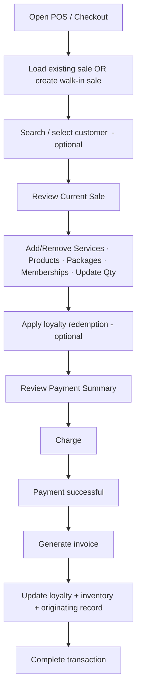
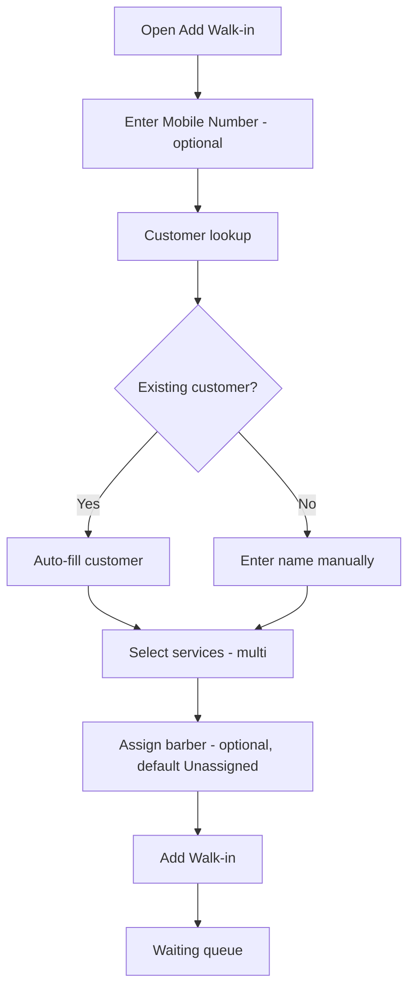
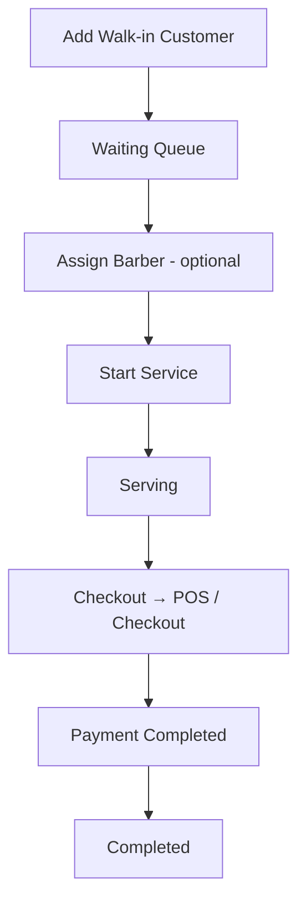

# POS / Checkout (incl. Walk-In Queue)

```
status: partially built — POS/Checkout direct-entry screen is live (apps/web/.../pos),
and Walk-In Queue (Part B below) is now BUILT — API (apps/api/.../walk-ins), web
(apps/web/.../queue), and entry point 3 of POS checkout (walkInId). Packages/
memberships, commission records, and stock locking remain not confirmed built — treat
the rest of this doc as the target spec, not a build report, until reconciled.
```

## Purpose

Central billing and payment module: processes customer transactions, collects payments, applies discounts and loyalty redemptions, calculates taxes, awards loyalty points, and completes the sale from a single checkout workflow. In the 2026 req the module has **three entry points** — Direct Walk-in Checkout, Checkout from Appointment, Checkout from **Walk-In Queue** — all of which funnel into the same checkout screen. POS is the operational hub connecting Customers, Appointments, Services, Catalog (services/products/packages/memberships), Inventory, Finance, Payroll (commissions), Loyalty, and Reporting. Bilingual EN + AR (RTL); currency OMR with 3 decimals (baisa — all arithmetic in BIGINT baisa).

This doc covers two sub-modules:
- **POS / Checkout** — the billing screen (Current Sale + Payment Summary + Charge).
- **Walk-In Queue** — a NEW operational queue-management module (List + Board views) that registers walk-in customers and hands them off to POS as the third checkout entry point.

## Primary users / permissions

Receptionists, Cashiers (primary POS + Walk-In Queue); Branch Managers (can change Sales Executive / assigned barber, discount permissions). Branch-scoped: cashier/receptionist operates within selected/assigned branch. `getEffectiveBranchIds()` scopes both the catalogue and the queue.

---

# Part A — POS / Checkout

## Entry points (three)

Regardless of entry point, all transactions run the **same** checkout workflow.

1. **Direct Walk-in Checkout** — opens a new blank sale; customer selection optional; items added manually.
2. **Checkout from Appointment** — system auto-loads: Appointment reference, Customer, Services booked, Assigned barber, Current service total. Cashier may modify before payment.
3. **Checkout from Walk-In Queue** — system auto-loads: Queue reference, Customer, Services performed, Assigned barber, Current service total. Cashier may modify before payment.

For appointment- or queue-originated sales, the system **retains the original appointment/queue reference** while allowing modifications; on completion it marks that originating record as checked out / billed.

## Screens & flows

### 1. Customer selection

- **Customer Search** — searches existing customers by **Mobile Number**, **Customer Name**, or **Membership Number**. On selecting a customer, the system loads: Customer profile, Loyalty account, Membership information (if applicable).
- If no customer is selected, the sale continues as a **Walk-in Customer**.

*(The req describes search + walk-in fallback only. It does NOT restate the old doc's explicit "[+ Add Customer]" inline-create sub-flow or the "Sales Executive" selector — see Open questions.)*

### 2. Service & Product selection (left panel — catalogue)

Four category tabs (changing tab refreshes the available items):
- **Services**
- **Products**
- **Packages** *(promoted from deferred — now in scope)*
- **Memberships** *(promoted from deferred — now in scope)*

**Item card** fields:
| Field | Notes |
|---|---|
| Icon / Image | Visual representation |
| Item Name | Service, product, package, or membership name |
| Duration | Services only |
| **Brand** | Retail products only, where applicable |
| Price | Selling price (stored as BIGINT baisa) |

Selecting an item **immediately adds it to the Current Sale**.

### 3. Current Sale panel (was "Shopping Cart")

Lists all items in the transaction. Each row displays:
- Item Name (service/product/package/membership)
- Unit Price (selling price)
- Quantity
- Increase Quantity (+) — +1
- Decrease Quantity (−) — −1
- Remove Item

Totals recalculate automatically on every change.

### 4. Modify Current Sale

Before payment the cashier may: add/remove services, add/remove retail products, add/remove service packages, add/remove memberships, update item quantities. Available for all three entry points; appointment/queue reference is preserved through edits.

### 5. Loyalty (redeem + earn)

**Redeem** — if the customer has sufficient points, the cashier may apply them to reduce the payable amount. The system displays available points; cashier redeems **all available points OR a specific number entered by the customer**; payable amount updates automatically; points are deducted **after** successful payment.

**Earn** — after successful payment the customer earns points, calculated from Total eligible spend, Customer loyalty tier, and Loyalty programme configuration; credited automatically.

### 6. Payment Summary (was "Order Summary")

Financial breakdown, all values auto-recalculated on any change:
1. **Subtotal** — total value of all sale items before tax and discounts
2. **Discounts** — total promotional or manual discounts applied, if any
3. **Loyalty Redemption** — value deducted through redeemed points
4. **VAT** — applicable tax amount
5. **Total** — final payable after all adjustments

### 7. Charge (was "Pay & Complete")

Selecting **Charge** initiates payment. After successful payment the system:
- Records the completed sale
- Generates the invoice
- Updates inventory for sold **retail products only**
- Updates the customer's purchase history
- Deducts redeemed loyalty points (if used)
- Credits newly earned loyalty points
- Updates the originating Appointment or Walk-In Queue record as **checked out** (if applicable)

## POS flow



## POS business rules (from req)

- Supports direct walk-in, appointment checkout, and Walk-In Queue checkout — all one workflow.
- Appointment-opened transactions are preloaded with appointment details; Walk-In-Queue-opened transactions are preloaded with the completed services.
- Preloaded transactions may be modified before payment (add/remove services, products, packages, memberships).
- Quantity adjustments immediately update totals.
- Loyalty redemption reduces the final payable amount; requires sufficient points per the configured programme.
- On successful payment: redeemed points deducted, new points credited based on spend + tier.
- Completing checkout from an Appointment or Walk-In Queue updates the originating record to indicate billing complete.
- Inventory is updated **only** for retail products in the transaction.
- A sales invoice is generated automatically after successful payment.

---

# Part B — Walk-In Queue (BUILT)

Operational queue-management module handling the full lifecycle of walk-in customers — from registration until transfer to POS / Checkout. Unlike Appointments, the workflow is deliberately simple. Provides two visualisations of the **same** data: **List View** (tabular, for reception) and **Board View** (grouped by status).

**Built**: API (`apps/api/src/modules/walk-ins/` — list/stats/create/getById/update/assignBarber/start/complete/cancel, mounted at `/walk-ins`), web (`apps/web/.../queue/` — `queue-content.tsx` List/Board toggle via `BoxedToggle`, `walk-in-board.tsx`, a `Drawer`-based Add Walk-in form reusing the Appointments wizard's service-card toggle pattern), and the POS checkout integration (`walkInId` on `CheckoutSchema` — the Serving → Completed transition is only ever reached this way, mirroring the req's "Checkout+Charge success" arrow). Barber assignment reuses the existing `GET /appointments/barbers` endpoint rather than a duplicate. The same `Drawer` also opens in a read-only "view" mode (an Eye action on every List row/Board card) showing a details panel — see §2a. Memberships/Packages/Products are out of scope for the queue itself (not built anywhere yet) — only Services.

## Lifecycle / status machine

```
Add Walk-in → Waiting → Serving → Checkout → Completed
```

Exact statuses referenced by the req: **Waiting**, **Serving**, **Completed** (Checkout is the transition action that opens POS; on payment success the record becomes Completed). See Status machine below.

## Module navigation

```
Walk-in Queue
├── List View
├── Board View
└── Add Walk-in
```

## Screens & flows

### 1. Walk-In Queue Dashboard

Real-time overview of all walk-in customers and current status.

**Dashboard summary (stats, top section):**
1. **In Queue** — total customers currently waiting; auto-updates as customers enter/leave the waiting queue.
2. **Serving Now** — number currently receiving services.
3. **Done Today** — total completed walk-in services for the current day.
4. **Average Wait** — average customer waiting time; auto-updates as queue activity changes.

**View selection** — toggle List View / Board View.

**Branch Selection** — displays the currently selected branch; changing branch refreshes the queue for that location.

**Add Walk-in** — opens the Add Walk-in Customer dialog.

### 2. Add Walk-in Customer (dialog)

Registers a new walk-in; on success the customer enters the Waiting Queue.

| # | Field | Type | Req'd | Behaviour |
|---|---|---|---|---|
| 1 | **Mobile Number** | Text | Optional | On entry, searches the Customer database (see lookup below). |
| 2 | **Customer Name** | Text | — | Auto-populated for existing customer (after mobile lookup); entered manually for a new customer. |
| 3 | **Services** | Multi-select cards | ≥1 | Service card shows Service Name, Duration, Price. Multiple services selectable; total updates automatically. |
| 4 | **Total** | Computed | — | Total value of selected services; auto-recalculated as services change (baisa). |
| 5 | **Barber** | Select | Optional | Lists available barbers; **default = Unassigned**; may be assigned now or later. |
| 6 | **Add Walk-in** | Action | — | Creates the queue entry; customer immediately appears in Waiting. |

**Existing Customer Lookup** — when a mobile number is entered the system searches Customers. Match → Customer Name auto-populated and the walk-in is linked to the existing customer profile. No match → treated as a new walk-in.

**Add Walk-in dialog flow:**



### 2a. Walk-in Details (view / edit) — BUILT, not in the original req

Opened by an Eye action on any List row or Board card, regardless of status — reuses the
same `Drawer` as Add Walk-in, in a read-only "view" mode:

- **Profile** — customer name/mobile, branch, queued-at timestamp, status badge, the
  selected services with their snapshotted prices and total.
- **Assign Barber** — the same inline barber `<Select>` already on the List/Board, wired
  to the same reassignment endpoint — works directly from the details view, no separate
  step.
- **Status actions** — the same Start/Cancel/Checkout/Complete actions available on the
  List/Board for that entry's current status, reusing the same transition endpoints.
- **Edit** — shown only while the entry is **Waiting** or **Serving**; switches the drawer
  to Add Walk-in's own form (pre-filled) to change Customer Name, Mobile Number, and/or
  Services. Saving calls `PATCH /walk-ins/:walkInId` (`UpdateWalkInSchema`, `walkin.update`):
  services, if changed, are re-snapshotted and the total recomputed server-side exactly
  like registration; a changed mobile re-links (or creates) a Customer by the new number
  without touching the previous customer's own record. Branch and barber aren't editable
  here — branch is fixed at registration, barber stays on its own dedicated reassignment
  control. Once an entry is **Completed** or **Cancelled** editing is blocked
  (`WALKIN_NOT_EDITABLE`, 409) — a checked-out entry's record (and any linked invoice) is
  final, so Edit isn't even shown once the entry leaves the active queue.

### 3. Waiting Queue

Customers waiting to receive service. Each card/row displays:
- **Customer** — name
- **Selected Services** — services requested
- **Assigned Barber** — barber or **Unassigned**
- **Waiting Time** — live waiting duration
- **Status** — Waiting
- **Actions** — View / Start / Cancel

**Assign Barber** — a customer may enter the queue without a barber; the receptionist can assign or change the barber directly from the queue; selecting a barber immediately updates the record.

**Start Service** — selecting Start: status Waiting → Serving; customer moves to the Serving section; the service timer continues from the recorded queue time.

### 4. Serving

Customers currently receiving services. Each card displays:
- **Customer** — name
- **Selected Services**
- **Assigned Barber** — barber or Unassigned
- **View** — opens the details panel (§2a)
- **Checkout** — opens POS / Checkout
- **Complete** — marks service as completed

**Checkout** — opens POS / Checkout and auto-transfers: Customer, Walk-in Queue Reference, Selected Services, Assigned Barber, Service Charges. In POS the cashier may add services, remove services, add/remove retail products, add memberships, apply loyalty redemption, and complete payment. No re-entry required.

### 5. Completed

After successful payment the walk-in is marked **Completed**. Completed customers remain visible in the Completed section for the remainder of the day.

### 6. List View

Table of walk-in customers. Columns:
- **Customer** — name and contact information
- **Services** — selected services
- **Barber** — assigned barber
- **Wait** — current waiting time
- **Status** — Waiting, Serving, or Completed
- **Actions** — operational actions available for the current status

Selecting an action updates the queue immediately.

### 7. Board View

Groups customers into three operational columns: **Waiting**, **Serving**, **Completed**. Same underlying data as List View; only presentation differs.

## Walk-In Queue flow



## Walk-In Queue business rules (from req)

- Walk-in customers may be registered **with or without** a mobile number.
- If a mobile number is entered, the system searches for an existing customer and auto-populates the name on match (and links the profile).
- Multiple services may be selected during registration; the total recalculates automatically as services change.
- A barber may be assigned during registration or later while the customer is in the queue; customers without a barber remain **Unassigned**.
- Start changes status Waiting → Serving.
- Checkout opens POS / Checkout with all customer and service information preloaded; the transaction remains fully editable before payment.
- After successful payment the customer moves to Completed.
- List View and Board View display the same queue data; only presentation differs.

---

## Data model / fields

### Walk-In Queue (new tenant tables — RLS required)

- **`walkin_queue_entries`** — `id`, `tenant_id`, `branch_id`, `customer_id` (nullable — walk-in may be anonymous or linked), `customer_name` (denormalized for anonymous walk-ins), `mobile_number` (nullable), `barber_staff_id` (nullable → Unassigned), `status` (enum: `waiting | serving | completed`; plus `cancelled` — inferred from the Cancel action), `queued_at` (drives Waiting Time / Average Wait), `serving_started_at` (nullable), `completed_at` (nullable), `total` (BIGINT baisa — sum of selected service prices at registration), `invoice_id` (nullable — set on checkout completion), `appointment_id` (null; queue and appointment are distinct origins), timestamps.
- **`walkin_queue_services`** — line items of requested services: `id`, `tenant_id`, `queue_entry_id`, `service_id`, `unit_price` (baisa), `qty`. (Services performed transfer into POS `invoice_items`.)

### POS / Checkout (existing model — retained)

`invoices` (per-branch invoice_number sequence, nullable `customer_id`, `subtotal`/`discount`/`loyalty_redeemed`/`vat`/`total` in baisa, status `paid | partially_paid | void`, cashier/sales-executive id, nullable `appointment_id`, nullable `walkin_queue_entry_id`), `invoice_items` (item_type `service | product | package | membership`, `staff_id`, `qty`, `unit_price`, line totals — **item_type extended** to cover packages + memberships), `payments` (method `cash | card | mada | bank_transfer | ewallet`; split = multiple rows), `stock_levels` + `stock_movements` (type sale; retail products only), `finance_transactions` (sale_revenue), `loyalty_accounts` + `loyalty_transactions` (redeem + earn), `commission_rules` + `commission_records`, `customers`, `services` / `branch_services`, `products` (with `brand`), `packages`, `memberships`, `audit_logs`.

## Status / state machines

### Walk-In Queue entry

```
waiting ──Start──▶ serving ──Checkout+Charge success──▶ completed
   │                  │
   └──Cancel──▶ cancelled  (Cancel action shown on Waiting; inferred terminal state)
```

- Timer/Waiting Time accumulates from `queued_at`; on Start the timer "continues from the recorded queue time" (req) — i.e. Waiting Time is measured from `queued_at`, not reset on Start.
- `completed` is reached only via a successful POS payment; Checkout alone (opening POS) does not complete the entry.

### Invoice (retained)

`paid | partially_paid | void` — see Money invariant below.

## Integrations

- **Appointments** — entry point 2; completed appointment preloads cart (services + barber + total); marked checked-out on Charge.
- **Walk-In Queue** — entry point 3 (this doc, Part B); preloads services performed + barber; marked Completed on Charge.
- **Customers** — search by mobile/name/membership; walk-in mobile lookup; purchase history update.
- **Catalog** — Services, Products (with Brand), Packages, Memberships tabs.
- **Inventory** — stock deduction for retail products only.
- **Finance** — sale revenue transactions.
- **Loyalty / Memberships** — redeem + earn; membership sale + membership-number lookup.
- **Payroll / Commissions** — commission on services performed (by assigned barber / sales executive).
- **Reporting / Dashboards** — daily sales; queue stats (In Queue, Serving Now, Done Today, Average Wait).

## Engineering notes (preserved invariants — the req does not restate these but they remain valid)

- **Server-side recompute**: cart/queue totals are **recomputed server-side at checkout**; client totals are advisory only.
- **Single checkout transaction** (design-app.md §2): validate cart → `invoices` + `invoice_items` + `payments` → inventory deduction + `stock_movements` → `finance_transactions` → loyalty redeem/earn → `commission_records` → update originating `appointments`/`walkin_queue_entries` → `audit_logs` → commit; then emit `pos.sale.completed` (notifications only, via BullMQ).
- **Idempotency-Key** header on checkout/payments (Redis SETNX, 24h) — duplicate submits return the original result.
- **SELECT FOR UPDATE**: stock rows locked in deterministic order; negative stock blocked unless the product allows it. Queue-entry status transitions (Start / Checkout / Complete) should lock the row to avoid concurrent double-serve/double-complete.
- **RLS / tenant isolation**: every tenant table (incl. new `walkin_queue_entries`, `walkin_queue_services`) has `tenant_id` + RLS (ENABLE + FORCE) + `tenant_isolation` policy, added in the same migration. Runtime = `hayryou_app`; queries via `PrismaService.client` / `withTenantTx()`.
- **Money**: integer minor units + ISO 4217 (OMR exponent 3 = baisa; BIGINT). Rounding invariant (property-tested): `sum(lines) − discounts − loyalty_redeemed + VAT === total === sum(payments)` in baisa. All arithmetic via `packages/shared/src/money.ts`.
- **API contract**: zod schemas in `packages/shared` first (walk-in create, queue transition, checkout) → `createZodDto` in API → same schema in web forms. Stable `code`s from `ERROR_CODES`; clients never match on message text.
- **Permissions**: keys in `packages/shared/src/permissions.ts`; guards `@Permissions(...)`, `@BranchScoped(...)`; queue + POS list queries scope via `getEffectiveBranchIds()`. Walk-in Queue's own keys (`walkin.view`/`walkin.create`/`walkin.update`/`walkin.cancel`/`walkin.checkin`) are seeded to Receptionist, Cashier, Branch Manager (full set) and Barber/Operations Manager (`walkin.view` only), mirroring the Appointments precedent. `walkin.update` gates both the barber-reassignment endpoint (`PATCH /walk-ins/:walkInId/barber`) and the details-edit endpoint (`PATCH /walk-ins/:walkInId`, §2a) — the latter additionally enforces `WALKIN_NOT_EDITABLE` (409) once the entry is `completed`/`cancelled`, independent of the caller's permissions. **Confirmed gap**: `pos.discount.manual` and `pos.refund` are seeded to some roles (e.g. Branch Manager) but `POST /pos/checkout` only checks `pos.use` — manual discount is unenforced for every role that can reach checkout at all, and there's no refund/void endpoint yet. The web form intentionally leaves the discount field ungated client-side too, since hiding it for some roles while the server accepts it from anyone would be a false sense of security, not a fix. Wire the server check first if this needs to actually be enforced.
- **Walk-in anonymity**: `invoices.customer_id = NULL` for anonymous walk-ins; no loyalty earn/redeem without a customer.

## ⚠️ Changed in this revision

- **NEW Walk-In Queue sub-module** — did not exist in the prior doc. Full lifecycle (Waiting → Serving → Checkout → Completed), List + Board views, dashboard stats (In Queue, Serving Now, Done Today, **Average Wait**), Add Walk-in dialog (optional mobile + existing-customer lookup, name, multi-select services with auto-total, barber default **Unassigned**, assignable at registration or later). Requires new tenant tables `walkin_queue_entries` / `walkin_queue_services`.
- **Third POS entry point** — Walk-In Queue joins Direct and From-Appointment as a first-class checkout origin; originating queue record is updated to Completed on Charge.
- **Packages & Memberships promoted from deferred to in-scope** — catalogue now has **4 tabs** (Services / Products / Packages / Memberships); `invoice_items.item_type` extended to `service | product | package | membership`.
- **Membership-number search** added as a customer-search key (was mobile + name only).
- **Product Brand field** now surfaced on the POS product item card.
- **Terminology renames** — "Shopping Cart" → **Current Sale**; "Order Summary" → **Payment Summary**; "Pay & Complete" → **Charge**.
- **Loyalty redemption granularity clarified** — cashier may redeem **all** available points OR a **specific number entered by the customer**.
- **Order-summary line simplification** — the 2026 req lists Subtotal / Discounts / Loyalty Redemption / VAT / Total. It drops the prior doc's explicit sub-breakdown of Discount (Manual / Promotional / Membership) and the separate **"Loyalty Earned"** summary line (earn is still described in the Loyalty section, just not in the summary) — see Open questions.

## ❓ Open questions / needs client confirmation

- **Payment-methods detail** — the 2026 req names only "Charge" and never enumerates methods. Prior doc specified **Cash / Card / Mada / Bank Transfer / eWallet / Split Payment** with worked OMR examples (Cash change; split rows). *Previously specced; not present in 2026 client doc — confirm DE-SCOPED vs DEFERRED.* (Recommend retaining — `payments` model already assumes them.)
- **Suspend / Resume Sale** (parked carts) — in prior doc's More-actions; absent from 2026 req. *Previously specced; confirm DE-SCOPED vs DEFERRED.*
- **Cash drawer / payment ledger + End Shift** — prior doc's "update branch cash drawer", Open Cash Drawer, End Shift / shift reconciliation. Absent from 2026 req. *Previously specced; confirm DE-SCOPED vs DEFERRED.*
- **Manager discount permissions** — prior doc gated discounts behind permission validated at Pay & Complete. The 2026 req shows a "Discounts" summary line but no application UI or permission rule. *Previously specced; confirm DE-SCOPED vs DEFERRED* (and where discounts are entered).
- **In-POS Branch selector + branch-change side-effects** — prior doc's header Branch selector (re-loads inventory/prices/taxes/promotions/staff). 2026 POS req omits it (though Walk-In Queue has a branch selector). *Confirm whether POS still exposes an in-screen branch switch.*
- **Pre-add stock-availability check** — prior doc checked stock **before** adding a product to cart. 2026 req only deducts inventory at Charge. *Confirm whether the pre-add availability guard is retained.*
- **SKU / Barcode search** — prior doc searched products by SKU + Barcode; 2026 catalogue search/tabs don't mention it. *Confirm DE-SCOPED vs DEFERRED.*
- **Inline "[+ Add Customer]"** at POS — prior doc allowed creating a customer mid-sale (Full Name / Mobile / Email, mobile-dedupe). 2026 req describes search + walk-in fallback only. *Confirm DE-SCOPED vs DEFERRED* at POS itself. **Resolved for Walk-in Queue**: a mobile entered with no match auto-creates a real Customer record (product decision, consistent with [[customers]]'s single-source-of-truth design) — `WalkInsService.create`'s `resolveCustomer` upserts on `(tenantId, mobile)`, same pattern as `AppointmentsService.resolveCustomer`. No mobile at all stays fully anonymous (`customerId` null).
- **Sales Executive selector** — prior doc's employee-processing-the-sale field (auto = logged-in user, manager-changeable; drives commission/cashier reports). 2026 req doesn't mention it explicitly. *Confirm whether it stays* (needed for commission attribution; also how it relates to the queue's Assigned Barber).
- **"Loyalty Earned" summary line** — dropped from the 2026 Payment Summary list though earn logic is retained. *Confirm whether the earned-points preview should still display in the summary.*
- **Discount sub-types** — Manual / Promotional / Membership breakdown from prior doc collapsed to a single "Discounts" line. *Confirm the discount taxonomy and which are supported.*
- **Cancel action terminal state — BUILT as inferred**: `WalkInStatus` has a `cancelled` state, reachable only from `waiting` (`WALKIN_TRANSITIONS`). Cancelled entries drop out of the List status filter's "all" default (still queryable by `?status=cancelled`) and out of the Board's three columns entirely. *Still open:* whether cancelled walk-ins should be retained/reported anywhere beyond the raw table — no reporting surface exists yet (Reports module isn't built).
- **Walk-in details view/edit — BUILT, not in the original req**: the client doc never specified an edit path for a registered walk-in; this was added so reception can correct a mis-entered name/mobile/service selection without cancelling and re-registering. See §2a for the full behavior (editable fields, re-snapshot/re-link rules, the `WALKIN_NOT_EDITABLE` cutoff once completed/cancelled).
- **Average Wait computation — BUILT, implementation choice, not client-confirmed**: mean minutes of `(servingStartedAt ?? completedAt − queuedAt)` over today's entries that have left Waiting (`serving`/`completed`), scoped to entries queued today; still-waiting customers don't count toward the average (their wait is open-ended). See `WalkInsService.stats()`.
- **Membership sale vs discount** — Memberships appear both as a purchasable cart tab and as a customer attribute driving discount eligibility. *Confirm the membership purchase → activation → discount-eligibility flow at POS.*
- **Package sale mechanics** — packages are now a cart tab; confirm how a sold package's included services/redemptions are modelled (immediate entitlement vs later redemption) and any inventory/consumable reservation.
- **Mada terminal integration** — hardware/gateway vs record-only payment method. Prior doc assumed record-only for MVP; unchanged by 2026 req.
- **Consumable deduction on service completion** (`service_consumables`) — at POS checkout or at appointment/queue completion? Design implies the POS checkout tx handles consumption.
