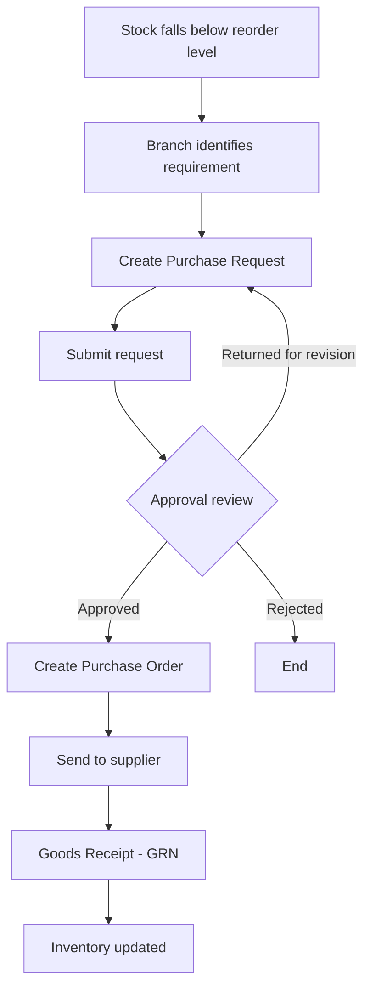

# Procurement

```
status: planned
```

> **Deferral note (design-app.md §9):** the full PR/PO/GRN chain is deferred from MVP — MVP uses manual stock adjustments in Inventory. Schema (`purchase_requests`, `purchase_orders`, `goods_receipts`, `suppliers`) exists so the module bolts on without migration surgery.

## Purpose

Purchasing and inventory-replenishment workflow: branches request stock (PR), approvals convert requests to supplier orders (PO), goods are received (GRN), and inventory is updated. Bilingual EN + AR (RTL); amounts in OMR 3 decimals (baisa).

## Primary users / permissions

Branch staff (create PRs), Procurement Manager / Branch Manager / authorized staff (approvals), Operations/Admin (POs, suppliers, reports).

## Module navigation

```
Procurement
├── Dashboard
├── Purchase Requests (PR)
├── Purchase Orders (PO)
├── Goods Receipt (GRN)
├── Suppliers
├── Purchase History
├── Approvals
└── Reports
```

## Screens & fields

### 1. Procurement Dashboard

Central monitoring and decision-making screen. Real-time overview of: Purchase Requests, Purchase Orders, Goods Receipts, Supplier Performance, Low Stock Items, Procurement Spending. Answers:
- What needs to be purchased?
- What requests require approval?
- Which orders are pending delivery?
- Which inventory items are running low?
- Which suppliers are performing best?
- How much have we spent this month?

### 2. Purchase Request (PR)

First step of procurement: a branch/department formally requests inventory replenishment before a PO is issued to a supplier.

**PR form fields**
1. Branch — branch requesting inventory
2. Request Date
3. Requested By — employee creating the request
4. Priority — Low (routine) | Normal (standard replenishment) | Urgent (immediate requirement)
5. Required by Date — expected date inventory is needed
6. Reason — business justification
7. Add Requested Items — per line:
   - Select existing inventory item
   - Desired quantity
   - Current Stock — auto-displayed
   - Reorder Level — auto-displayed
   - Estimated Unit Cost — pulled from inventory or supplier history
   - Estimated Total — auto-calculated
   - Remarks
8. Attach Supporting Documents
9. Save Draft or Submit

### 3. Purchase Order (PO)

Generated from an approved PR. PO list → View PO → PO details with actions: Print PO, Send To Supplier, Edit PO, Receive Goods, View Activity.

### 4. Goods Receipt (GRN)

Used when items are physically received from suppliers against an approved PO. Bridge: Purchase Order → Goods Receipt (GRN) → Inventory Update.

## Flow — PR → Approval → PO → GRN → Inventory update



### Approval actions
Procurement Manager / Branch Manager / authorized staff review PRs and take one of:
- **Approved** — system allows Purchase Order creation
- **Rejected** — request closed
- **Returned for Revision** — requester edits and resubmits

## Business rules

- Trigger: stock falling below reorder level (low-stock alerts) initiates the requirement.
- PRs support Draft state before submission.
- POs can be created only from approved PRs.
- GRN receipt writes `stock_movements` of type `grn_receipt` and increments `stock_levels.qty_on_hand` at the receiving branch.
- Partial receipts: GRN quantities recorded against PO lines (implied by GRN-per-PO structure).

## Data-model touchpoints

`purchase_requests` + items, `purchase_orders` + items, `goods_receipts` + items, `suppliers`, `products`, `stock_levels`, `stock_movements` (grn_receipt), `finance_transactions` (supplier payments — see finance.md), `audit_logs`.

## Open questions

- PR/PO/GRN status enums are not enumerated in the PDF (Draft/Submitted/Approved/Rejected/Returned for PR; PO lifecycle e.g. Draft/Sent/Partially Received/Closed) — define at build time.
- Approval routing rules (who approves what, thresholds by amount/branch) unspecified.
- Supplier Performance metrics on the dashboard (on-time delivery? price variance?) unspecified.
- Whether PO cost updates `products` unit cost (moving average vs last cost) — undefined.

## Reconciliation vs 2026 client requirement doc

- Reviewed against the 2026 req (PROCUREMENT section) — the req's PR → Approval → PO → GRN → Inventory-update flow, its forms, and its actions are a **strict subset** of this doc. No contradictions; this doc is richer.
- ✅ **Procurement is IN SCOPE and retained** as the full spec above. The req actively presents the **full procurement chain** (PR → Approval → PO → GRN → Inventory-update) and lists Procurement/Goods-Receipt as a live **stock-increase source** feeding [[inventory]] — so this is a client-confirmed requirement, not just an excerpt gap.
- ⚠️ **Sequencing note (not a scope question):** our ROADMAP had the procurement chain **deferred** (MVP = manual stock adjustments, per the deferral note at the top of this doc). The 2026 req pulls it forward — update ROADMAP phasing accordingly; the manual-adjustment path in [[inventory]] remains the fallback until the chain ships.
